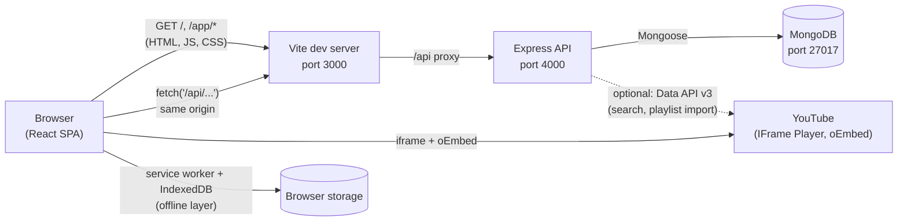

# No Distractions — Project Overview

> **Start here.** This file is the map. Each section links to deeper
> documents that expand on the *what, why, how, why-this-way, trade-offs,
> alternatives, limitations, and how-to-modify* of every important part.

## 1. The Problem This Project Solves

YouTube is an extraordinary learning resource, but the surrounding
experience is engineered for engagement, not learning. A learner who
opens a lecture is shown recommendations, comments, autoplay previews,
and a sidebar of unrelated content the moment the video ends. The
learner's intention — *"watch this, take notes, come back later"* — is
in tension with the platform's incentive to keep them watching
something else.

**No Distractions** strips away the parts of YouTube that compete for
attention while keeping the part that matters: the official embedded
player. Learners paste a video link, watch it in a calm interface, save
it to a personal library, organize saved videos into playlists, take
timestamped notes, place bookmarks at moments they want to revisit, and
resume where they left off. Nothing about the player itself is
modified — ads, captions, and any YouTube-imposed restrictions still
apply exactly as on youtube.com. What is removed is the *chrome*:
recommendations, comments, the next-video suggestion, the endless
feed.

The project is also a deliberate reference implementation of the MERN
stack (MongoDB, Express, React, Node.js). The codebase is structured to
be read end-to-end, and this documentation set is written so a developer
who reads it can explain every meaningful decision in an interview,
debug a failure, and extend the app without copying patterns blindly.

## 2. Main Features (and where they live)

| Feature | Frontend | Backend |
| --- | --- | --- |
| Landing page (pitch + signup) | `client/src/pages/Landing.jsx` | — |
| Auth (signup / login / logout / me) | `client/src/context/AuthContext.jsx`, `pages/Login.jsx`, `pages/Signup.jsx` | `server/src/routes/auth.js`, `middleware/auth.js` |
| Dashboard (continue learning, recents, unfinished playlists) | `pages/Dashboard.jsx` | `routes/stats.js`, `routes/library.js`, `routes/playlists.js` |
| Watch page (player, save, focus mode, keyboard shortcuts) | `pages/Watch.jsx`, `components/YouTubePlayer.jsx` | `routes/videos.js`, `routes/library.js` |
| Library (filters, search, sort, "show more") | `pages/Library.jsx` | `routes/library.js` |
| Playlists (CRUD, reorder, import YouTube playlist) | `pages/Playlists.jsx`, `pages/PlaylistDetail.jsx`, `components/AddToPlaylistModal.jsx`, `components/PlaylistPanel.jsx` | `routes/playlists.js` |
| Notes (timestamped, click-to-seek) | `components/NotesSection.jsx`, `components/WatchSidebar.jsx` | `routes/notes.js` |
| Bookmarks (one-click position markers) | `components/BookmarksSection.jsx` | `routes/bookmarks.js` |
| Discover (search YouTube, preview/import playlist) | `pages/Search.jsx` | `routes/videos.js`, `utils/youtube.js` |
| Statistics (honest, computed) | `pages/Stats.jsx` | `routes/stats.js` |
| Focus mode (CSS + keyboard shortcuts) | `pages/Watch.jsx`, `client/src/index.css` (`.nd-focus`) | — |
| Offline support (SW + IndexedDB, progress queue) | `client/public/sw.js`, `client/src/lib/offline.js`, `lib/api.js`, `components/OfflineBanner.jsx` | — |

## 3. Tech Stack and the Purpose of Each Piece

| Layer | Choice | Why it is here |
| --- | --- | --- |
| Frontend runtime | React 19 + Vite 7 | Component-based UI with fast HMR in dev. See [`technologies-and-dependencies.md`](technologies-and-dependencies.md). |
| Routing | React Router 7 | The standard SPA router; declarative route table in `client/src/App.jsx`. |
| Styling | Tailwind CSS 4 | Utility-first styling with no separate CSS files per component. The whole design lives in a single `index.css` plus utility classes. |
| HTTP client | Native `fetch` (no axios) | The `api()` wrapper in `client/src/lib/api.js` adds auth, JSON handling, error shaping, and offline fallback — what axios would have given us, in 60 lines we control. |
| Backend framework | Express 5 | The minimal Node.js HTTP framework. Async error forwarding in v5 removes `try/catch` noise from routes. |
| Database | MongoDB via Mongoose 8 | Schema-flexible document store that fits our small, owned, hierarchical data (a `Playlist` embeds its entries; a `LibraryItem` holds both metadata and progress). |
| Auth | JWT + bcryptjs | Stateless sessions match a SPA + JSON API; hashes never leave the server. |
| YouTube | Official IFrame Player API + oEmbed (free); Data API v3 (optional, key-gated) | Compliance boundary: official documented endpoints only. See [`youtube-integration.md`](youtube-integration.md). |
| Offline | Service Worker + IndexedDB (no libraries) | Two narrow jobs (cache static shell; queue progress writes) that libraries would not improve. See [`offline-support.md`](offline-support.md). |
| Tests | `node:test` (built-in) + a bash/curl smoke script | No Jest/mocha dependency; the runner ships with Node. See [`testing.md`](testing.md). |
| Dev orchestrator | `concurrently` + a 40-line bash script | One terminal, three processes (Mongo, API, Vite). |

## 4. The Big Picture



**Three processes** run during development (`scripts/dev.sh` starts all
of them):

1. **Vite dev server** (`client/`, port 3000) — serves the React app
   *and* proxies `/api/*` to Express. Because the browser only ever
   talks to port 3000, there are no CORS headaches in development.
2. **Express API** (`server/`, port 4000) — a JSON REST API. Validates
   input, checks authentication and ownership, reads/writes MongoDB,
   and (optionally) calls the YouTube Data API for search/import.
3. **MongoDB** (port 27017) — the only persistent store on the server.

The YouTube iframe is embedded directly by the browser and talks to
YouTube itself. The server never proxies or transforms video traffic.
The browser also has a small offline layer (service worker +
IndexedDB) that caches the app shell and queues progress writes.

## 5. How Data Moves Through the Application

A single sentence describes most of the architecture: **the user
clicks → React calls `api()` → `fetch` to `/api/...` → Vite proxies →
Express runs middleware (auth, validation, rate limit) → Mongoose
queries MongoDB → JSON response → React state updates → UI
re-renders.**

The detailed version, using **saving a video** as the example, is in
[`request-lifecycle.md`](request-lifecycle.md) (10-step trace) and
in [`feature-walkthroughs.md`](feature-walkthroughs.md) (which adds 8
more lifecycles: login, watch+progress, notes, bookmarks, playlists,
search, offline, stats).

## 6. The Documentation Map

The docs are organized as a learning path. Read in this order if you
are new to the codebase:

| # | Document | Read this when… |
| --- | --- | --- |
| 0 | **This file** — `00-overview.md` | You want the map. |
| 1 | [`concepts-and-foundations.md`](concepts-and-foundations.md) | You need the prerequisite concepts (HTTP, REST, Express middleware, Mongoose, React state, async JS) explained *through* the code. |
| 2 | [`codebase-walkthrough.md`](codebase-walkthrough.md) | You want to know what each folder and significant file is for, and "what calls what". |
| 3 | [`api-and-data-design.md`](api-and-data-design.md) | You need to understand the schemas, indexes, endpoint contracts, and ownership model. |
| 4 | [`feature-walkthroughs.md`](feature-walkthroughs.md) | You want to trace a feature end-to-end across the stack. |
| 5 | [`technologies-and-dependencies.md`](technologies-and-dependencies.md) | You want to know why each library was chosen, and what alternatives exist. |
| 6 | [`decisions-tradeoffs-improvements.md`](decisions-tradeoffs-improvements.md) | You want the architectural trade-offs and honest limitations — useful for interviews. |
| 7 | [`practical-guides.md`](practical-guides.md) | You want to make a change (add a page / endpoint / model, debug something, write a test). |

The **existing per-feature docs** remain the reference for each
subsystem:

- [`architecture.md`](architecture.md) — component layout and dev workflow
- [`database-models.md`](database-models.md) — schemas, indexes, ownership
- [`authentication.md`](authentication.md) — JWT flow, password hashing, rate limiting
- [`youtube-integration.md`](youtube-integration.md) — player, oEmbed, Data API, quota
- [`progress-sync.md`](progress-sync.md) — the `savedAt` conflict rule
- [`offline-support.md`](offline-support.md) — service worker + IndexedDB
- [`security.md`](security.md) — what is and is not protected
- [`testing.md`](testing.md) — the two test suites
- [`request-lifecycle.md`](request-lifecycle.md) — one request, end to end

## 7. Trying It Out

```bash
# 1. Install
npm install
npm --prefix server install
npm --prefix client install

# 2. Configure
cp server/.env.example server/.env
#   edit server/.env — set a long random JWT_SECRET

# 3. Make sure MongoDB is running on 127.0.0.1:27017
#    (the dev script will start a project-local mongod if you have one)

# 4. Start everything
npm run dev

# 5. Run tests
npm test                  # node:test integration suite
bash scripts/api-test.sh  # live curl smoke test (needs the dev stack running)
```

Open <http://localhost:3000>. Sign up, paste a YouTube link on the
Dashboard, save it, take notes, place a bookmark, create a playlist —
the whole app is exercisable from the UI.

## 8. What This Documentation Will and Will Not Do

**Will do:**

- Explain the *why* of every important decision, not just the *what*.
- Reference real file paths and function names from the actual code.
- Distinguish intentional design decisions from existing limitations
  and from possible future improvements.
- Tell you how to extend each part without blindly copying patterns.

**Will not do:**

- Document features as complete if they are not implemented.
- Recommend replacing a technology merely because an alternative
  exists — only when the alternative would actually improve the project.
- Reproduce textbook material disconnected from the code. Concept
  introductions stay tight and project-anchored.

When a claim in this set couldn't be verified against the code, the
doc says so explicitly. Cross-references that look like
[`server/src/routes/library.js`](../server/src/routes/library.js) point
at real files in this repository.
