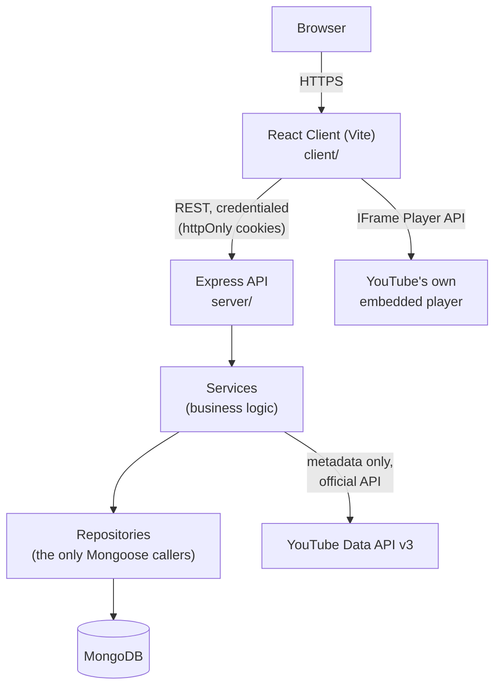

# 01 · Project Overview

## What is No Distractions?

No Distractions is a learning-focused player and library built around
YouTube's educational content. YouTube itself is one of the largest
libraries of free educational video in existence — and also one of the
most effective attention-capture products ever built. Recommendations,
Shorts, autoplay, and comments are not bugs from a learner's point of
view; they're a different product's success metrics leaking into yours.

No Distractions keeps the video — played through YouTube's own, officially
supported embedded player, never scraped or re-hosted — and removes
everything around it that isn't in service of learning, then adds back
what studying from video actually needs: notes tied to a timestamp,
bookmarks, resumable progress, playlists organized as courses, and a
focus mode.

It is a **learning platform built around YouTube's player**, not a
YouTube client and not a YouTube competitor.

## Why it exists

A student watching a lecture on YouTube today has to actively resist the
platform's own incentives every few minutes: an end-of-video suggestion
queue engineered for watch-time, not comprehension; a sidebar of "related"
videos; a comments section. None of that is malicious — it's just built
for a different goal than "help me learn this." No Distractions is built
for exactly one goal, and everything in the product principles below
follows from it.

## Product principles (in priority order)

1. **Learning** — every feature should make understanding the material
   easier, not just "engaging".
2. **Focus** — remove anything that competes for attention with the video
   and the learner's own notes.
3. **Simplicity** — a study dashboard, not a social feed.
4. **Speed** — a slow tool gets abandoned; performance is a UX feature.
5. **Minimal UI** — restraint over decoration (see the frontend design
   brief once the actual landing page/app-shell UI ships in Phase 3).
6. **Good UX** — obvious, predictable interactions.
7. **Accessibility** — keyboard navigation and screen readers are not an
   afterthought (see `docs/26-accessibility` once written).
8. **Maintainability** — code a stranger (or future-you) can pick up.

When two of these conflict, the earlier one wins — e.g. a feature that
would be more "engaging" but distracts from learning loses to principle 1.

## High-level architecture

Two separate integrations with YouTube, deliberately kept apart:

- **Metadata** (title, thumbnail, channel, duration) comes from the
  server, via the official YouTube Data API v3, and is cached in the
  `Video` collection.
- **Playback** happens entirely in the browser, through YouTube's own
  IFrame Player API — this app controls play/pause/seek and reads back
  the current timestamp, but the video stream itself never touches this
  app's server. See `docs/11-youtube-integration` (Phase 4) for the full
  legal/technical boundary, and the "YouTube-specific limitations"
  section of the Phase 1 delivery message for a summary.

## Current implementation status

Only the foundation described in Phase 1 exists so far: tooling, the
Express app skeleton (a health check, nothing else), and this
documentation structure. Every feature described above (notes, playlists,
progress, the actual player, focus mode, ...) is designed but not yet
built — see the root `README.md` for the phase-by-phase roadmap and
checklist.
