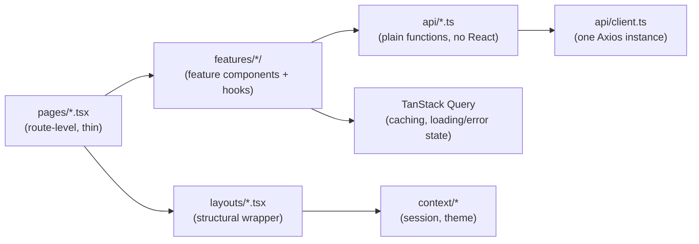

# 06 · Frontend Architecture

## The folder structure, and the reasoning behind it

```text
client/src/
├── api/         the HTTP boundary — one Axios instance + one wrapper module per resource
├── components/  shared, presentation-only UI (no data fetching)
├── context/     cross-cutting state — session, theme
├── features/    vertical slices — auth/, and videos/playlists/progress/notes/bookmarks once built
├── hooks/       reusable hooks with no feature attached
├── layouts/     structural wrappers — where things go on screen
├── pages/       one component per route; thin, composes the above
├── types/       shared TS types
└── utils/       pure, framework-agnostic helpers
```

Every one of these has its own `README.md` with the specific "belongs
here / doesn't belong here" rule — this page is about how they fit
together, not a repeat of each one.

## `features/` — organized by capability, not by technical type

The one deliberate departure from "put all components in `components/`,
all hooks in `hooks/`": `features/auth/` holds `LoginForm.tsx`,
`RegisterForm.tsx`, and — once they exist — auth-specific hooks, all
together. The alternative (a components-by-type structure) would scatter
everything belonging to "auth" across `components/`, `hooks/`, and
`pages/`, so understanding *or changing* one feature means jumping
between three unrelated folders. `features/` groups by what changes
together, not by what kind of file it is.

Not everything gets a `features/` folder immediately: the four dashboard
sections currently live in `pages/dashboard/`, not a
`features/dashboard/`, because they're empty states with no real data
logic yet — see `pages/dashboard/README.md`. A folder under `features/`
gets created when there's an actual feature (data + logic) to organize,
not preemptively.

## The layered request/render path



`api/*.ts` modules are plain TypeScript functions with no React import at
all — `registerRequest`, `fetchCurrentUser`, and so on. That boundary is
deliberate: it means every one of them is testable and reusable with zero
React machinery, and it's the exact seam `vi.mock('../api/auth')` uses in
every test in this codebase that touches auth (see
`docs/18-testing` once written) — mocking two files gets you a fully
isolated test of everything above them, the same benefit
`08-backend-architecture` describes for the repository layer on the
backend.

## Routing as architecture: layout routes

```tsx
// App.tsx
<Route element={<ProtectedRoute><AppLayout /></ProtectedRoute>}>
  <Route path="/dashboard" element={<DashboardPage />} />
  <Route path="/library" element={<LibraryPage />} />
  <Route path="/stats" element={<StatsPage />} />
</Route>
```

`ProtectedRoute` and `AppLayout` wrap the *route*, not each page. Every
current and future page nested here automatically gets the auth check
and the sidebar/topbar shell — a new authenticated page is one `<Route>`
line, not a page that remembers to import and wrap itself in both. This
is the same "handle it once, at the boundary" idea as the backend's
`requireAuth` middleware sitting on the route, not duplicated inside
every controller.

## Two providers, one pattern

`AuthProvider` and `ThemeProvider` are structurally identical: a
component that owns some state (one via TanStack Query, one via
`useState` + `localStorage`) and exposes it through a context value. Both
are split across three files for the same reason (`context/README.md`).
A third provider (say, a future `PlayerSettingsContext`) should follow
the same shape rather than inventing a new one.

## Try it yourself

`ThemeToggle` is a `components/` file, but it calls `useTheme()`, which
is context — doesn't that mean it "knows about" a specific concern the
same way a `features/` component would? Work out why it still belongs in
`components/` and not `features/`, using the rule in
`components/README.md`.
