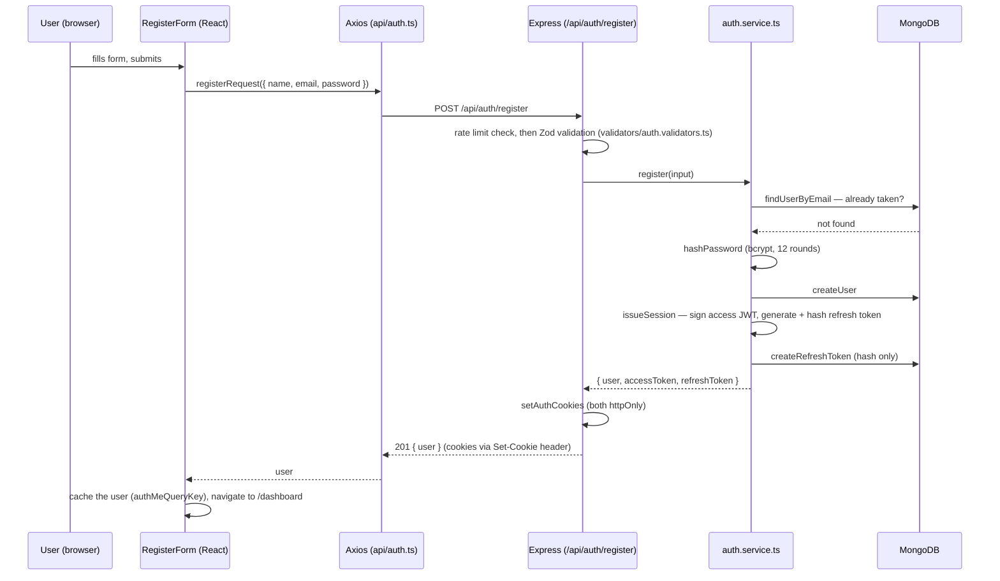

# 10 · Authentication

## Authentication vs. authorization

Two different questions, easy to blur together:

- **Authentication** — *who are you?* Proving identity, usually with a
  password. This document.
- **Authorization** — *what are you allowed to do?* In this project so
  far, authorization is simple: every user can only ever see their own
  data (every query filters by `req.userId`). It gets more interesting if
  a "shared playlist" feature is ever added — out of scope for now.

## Passwords, from first principles

A server should never be able to know a user's actual password — not
because of good manners, but because if the database is ever leaked
(breach, backup misconfiguration, disgruntled employee), plaintext
passwords instantly compromise every user's account on every other
service where they reused that password.

The fix is **hashing**: a one-way function that turns `"hunter2"` into
something like `$2b$12$KIXQ...` — computable in one direction, practically
impossible to reverse. At login, the server hashes the *submitted*
password with the same algorithm and compares hashes, never the plaintext.

**Why not a plain hash (SHA-256) instead of bcrypt?** SHA-256 is built for
speed, which is exactly wrong for passwords — it lets an attacker with a
stolen hash try billions of guesses per second on commodity hardware.
bcrypt is deliberately *slow*, and its cost (`SALT_ROUNDS = 12` in this
project's `server/src/utils/password.ts`) can be tuned upward as hardware
gets faster. It also generates a random **salt** per password
automatically, so two users with the same password get different hashes —
without a salt, an attacker could precompute a lookup table
("rainbow table") once and crack every matching hash in the database
instantly.

## JWTs, and why this project uses them for only half the job

A JSON Web Token (JWT) is a signed, self-contained credential: it carries
a payload (here, just `{ sub: userId }`) plus a cryptographic signature
that proves the server issued it. Anyone can *read* a JWT's payload (it's
just base64, not encrypted) — what they can't do is forge one without the
server's secret.

The useful property is **statelessness**: verifying a JWT is pure math
(check the signature), no database round-trip required. That's exactly
what you want for something checked on *every* request — this project's
**access token**.

It's a bad fit for something that needs to be revocable on demand (logout,
theft) — once issued, a stateless JWT stays valid until it expires, full
stop, unless you *also* keep server-side state to check against, at which
point you've given up the statelessness benefit anyway. So this project's
**refresh token** is deliberately not a JWT at all: it's a random opaque
string, checked against a database record every time (which is fine — it's
only checked roughly once every 15 minutes, not on every request), which
buys real, immediate revocability.

| | Access token | Refresh token |
|---|---|---|
| Format | JWT (signed) | Opaque random string |
| Lifetime | 15 minutes | 30 days |
| Checked via | Signature verification (no DB) | Database lookup (hashed) |
| Stored server-side? | No | Yes — hash only, in `RefreshToken` |
| Sent on | Every request | Only `/api/auth/*` |

## Cookies, and why not `localStorage`

The brief for this project explicitly rules out `localStorage` for
tokens, and for good reason: any JavaScript that runs on the page —
including an attacker's, via a successful XSS injection anywhere on the
site — can read `localStorage` freely and exfiltrate whatever's in it.

Both tokens are instead delivered as **`httpOnly` cookies**: the browser
stores and sends them automatically, but no JavaScript on the page (not
even this app's own) can read their value. That closes off token theft
via XSS entirely — an attacker who can inject a script still can't read
the cookie itself, only make requests that the browser will automatically
(and only) attach it to.

Two settings on those cookies matter:
- **`SameSite=Lax`** — the browser won't attach the cookie to most
  cross-site requests (another site trying to trigger authenticated
  actions on this one — CSRF), while still allowing it on normal
  navigation.
- **The refresh cookie's `path` is scoped to `/api/auth`** — the browser
  only attaches it there, not on every single request to the API, which
  keeps the one cookie capable of minting entirely new sessions off the
  wire for the vast majority of requests that have no reason to see it.

## How registration works, end to end

Login is the same shape, minus the "already taken" check — replaced with
`verifyPassword` against the stored hash (and a **constant-time-ish**
comparison against a dummy hash when the email isn't found at all, so a
nonexistent email and a wrong password take about the same time to
reject — see `utils/password.ts`'s `DUMMY_HASH`. This means both cases can
share the exact same error message, "Invalid email or password", without
revealing which one happened).

## Refresh: rotation and reuse detection

Every successful call to `POST /api/auth/refresh` does two things, not
one: it issues a *new* access+refresh pair, **and** it immediately marks
the refresh token that was just used as revoked. The client's cookies get
replaced with the new pair automatically (`Set-Cookie` on the response).

This is refresh token **rotation**, and it buys a genuinely useful
security property: if a refresh token is ever stolen (say, exfiltrated
from a backup or a compromised device) and the attacker uses it, the
*legitimate* user's next refresh attempt will find that their token was
already marked revoked — meaning it was already used since they last
saw it. `auth.service.ts`'s `refresh()` treats that specific
situation (a *revoked* token being presented again) as a signal of theft,
not just an expired session, and responds by revoking **every** active
session for that user — forcing a fresh login everywhere, on the
assumption that an attacker who could replay one refresh token might have
others too.

## Persistent authentication (staying logged in across a reload)

Nothing about "staying logged in" is special-cased on the frontend — it
falls out of the pieces above:

1. On every app load, `AuthContext` fires one `GET /api/users/me`.
2. If the access-token cookie is still valid → succeeds immediately.
3. If it's expired but the refresh-token cookie is still valid → the
   Axios response interceptor (`api/client.ts`) catches the resulting 401,
   calls `POST /api/auth/refresh` once, and — if that succeeds — retries
   the original `/me` request transparently. The user never sees a login
   screen.
4. If the refresh token is also gone/expired/revoked → the retry fails
   too, `user` stays `null`, and `ProtectedRoute` sends them to `/login`.

## Protected routes

`middleware/requireAuth.ts` on the backend, `components/ProtectedRoute.tsx`
on the frontend — both do the same conceptual job (no valid session, no
access) but neither trusts the other. The backend check is the one that
actually matters for security (a request to `/api/users/me` with no valid
cookie gets a 401 no matter what the frontend does); the frontend check
exists purely for UX, to redirect before ever rendering a page the API
would reject.

## Testing

`server/tests/auth.test.ts` mocks `repositories/user.repository.ts` and
`repositories/refreshToken.repository.ts` — no real MongoDB is used —
and then drives real HTTP requests at the real Express app with
Supertest. That means everything *except* the database is genuinely
exercised: Zod validation, rate limiting, password hashing, JWT signing
and verification, cookie handling, and all of `auth.service.ts`'s
branching (duplicate email, wrong password, expired/revoked/reused
refresh tokens). It specifically covers the reuse-detection path above —
see the test named `"treats a reused (already-revoked) refresh token as
theft"`. Also covered: the per-endpoint rate limits
(`tests/rateLimit.test.ts`), that an unexpected database error is masked
rather than leaked to the client, and that a racing duplicate signup maps
to a 409 instead of a 500.

What it does **not** cover: real Mongoose-level behavior (unique index
violations surfacing as the right error, actual TTL expiry on
`RefreshToken`). Wiring an actual test database is Phase 12 (Testing &
Hardening) work, or something you can do locally right now if you have
MongoDB running — the repository layer is real code, only mocked in this
particular test run.

## Tokens never appear in logs

A subtle way to undo everything above: request logging. pino-http's
default serializers log *every* header — including the `Cookie` request
header (both tokens) and the `Set-Cookie` response header (freshly issued
ones) — so a plain logger quietly writes live session credentials into
whatever stores your logs. `server/src/utils/logger.ts` redacts
`req.headers.cookie`, `req.headers.authorization`, and
`res.headers["set-cookie"]`, and `server/tests/logger.test.ts` fails if a
cookie value ever shows up in log output again.

## Known limitations

Honest list of what this design does *not* handle yet, so nobody assumes
otherwise:

- **Two tabs can trigger a false "theft" detection.** Rotation means a
  refresh token works exactly once. If two tabs' access tokens expire at
  the same moment, both fire a refresh with the same cookie; one wins and
  the other looks like a replayed token, so `refresh()` revokes *every*
  session and the user is logged out everywhere. The Axios interceptor
  de-duplicates refreshes *within* a tab, not across tabs. The usual
  mitigation is a short grace window during which a just-rotated token is
  still accepted; not implemented — revisit if it shows up in practice.
- **A dead session isn't noticed until the next session check.** If a
  session is revoked while a tab is open (logged out elsewhere, or the
  reuse detection above), that tab keeps showing the user as logged in
  until a reload, while individual API calls fail with 401. A global
  "session expired" handler is planned for Phase 13 (Production Polish).
- **Deployment constraints** (documented properly with the deployment
  guide): cookies are `SameSite=Lax`, so the client and API must be
  *same-site* (e.g. `app.example.com` and `api.example.com`) — two
  unrelated domains won't have cookies sent on cross-site XHR. And behind
  a reverse proxy, Express's `trust proxy` must be configured, otherwise
  the rate limiter sees the proxy's IP for every user and they share one
  10-attempt budget.
- **Not built:** email verification, password reset, "log out
  everywhere", CSRF tokens (`SameSite=Lax` covers the main cases; see
  ADR-002 for the Phase 13 hardening plan).

## Where things live

| Concern | File |
|---|---|
| Password hashing, timing-safe login | `server/src/utils/password.ts` |
| Access-token JWT, refresh-token generation | `server/src/utils/tokens.ts` |
| Cookie settings | `server/src/utils/cookies.ts` |
| Register/login/refresh/logout business logic | `server/src/services/auth.service.ts` |
| Route guard (backend) | `server/src/middleware/requireAuth.ts` |
| Request validation | `server/src/validators/auth.validators.ts` |
| Endpoints | `server/src/routes/auth.routes.ts`, `users.routes.ts` |
| Session state (frontend) | `client/src/context/` (`auth-context.ts`, `AuthContext.tsx`, `useAuth.ts`) |
| Refresh-and-retry on 401 | `client/src/api/client.ts` |
| Route guard (frontend) | `client/src/components/ProtectedRoute.tsx` |

Full reasoning for *why* this design over the alternatives:
[ADR-002](../22-architecture/decisions/ADR-002-authentication-strategy.md).

## Try it yourself

Trace a login request from the `LoginForm`'s submit handler all the way
to the `Set-Cookie` header on the response. List every file involved, in
order. (Answer: the sequence diagram above, but trace it in the actual
code rather than reading it off the diagram.)
