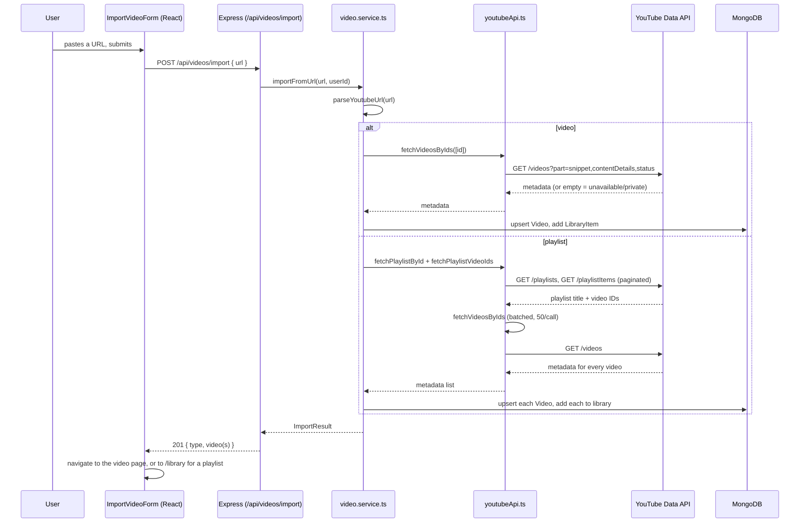

# 11 · YouTube Integration

## YouTube video/playlist IDs and URLs

Every YouTube video has an 11-character ID (`dQw4w9WgXcQ`) and every
playlist has an ID starting `PL` (plus a few other prefixes for special
playlist types this project doesn't need to handle). The same video can
be linked to several different ways:

```text
https://www.youtube.com/watch?v=dQw4w9WgXcQ        ← v= query param
https://youtu.be/dQw4w9WgXcQ                        ← short domain, ID in the path
https://www.youtube.com/watch?v=dQw4w9WgXcQ&list=.. ← video + playlist context together
https://www.youtube.com/playlist?list=PLxyz         ← a playlist itself
```

`server/src/utils/youtubeUrl.ts` is the one place in this codebase that
parses these — see its tests (`tests/youtubeUrl.test.ts`) for the exact
set of shapes recognized, including the deliberate choice that a URL with
both `v=` and `list=` imports just the one video, not the surrounding
playlist (that's a link to a specific video, not an invitation to import
everything around it).

## Two separate APIs doing two separate jobs

This is the most important thing to understand about this integration,
and it's covered in depth, with reasoning, in
[ADR-005](../22-architecture/decisions/ADR-005-youtube-embedding.md):

1. **YouTube Data API v3** — a REST API, called from the *server*, that
   answers "what is this video/playlist" (title, thumbnail, channel,
   duration, whether it can be embedded). Requires an API key. Never
   touches a video stream.
2. **The embedded player (IFrame)** — not an API call at all; just an
   `<iframe>` the *browser* loads directly from YouTube. This is what
   actually plays the video. No API key involved, no server round-trip.

A request to "import" a video only ever uses #1. Watching it only ever
uses #2. They don't share any code path, which is deliberate — it's what
makes it structurally impossible for a metadata request to accidentally
touch a video stream.

## Getting an API key (for local development)

1. Go to the [Google Cloud Console](https://console.cloud.google.com/apis/credentials)
   (a free Google account is enough; no billing setup is required for
   the Data API's free quota).
2. Create a project (or use an existing one), then **Enable APIs** →
   search "YouTube Data API v3" → Enable.
3. **Credentials** → **Create Credentials** → **API key**.
4. Restrict the key to "YouTube Data API v3" specifically (the
   Credentials page has a restriction option) — good practice for any API
   key, and costs nothing to do.
5. Put it in `server/.env` as `YOUTUBE_API_KEY=...`. The server validates
   this is present at startup (`config/env.ts`) and refuses to boot
   without it, the same as every other required secret.

## Quota

The free tier is 10,000 units/day, reset at midnight Pacific time. This
project's calls are cheap: `videos.list` and `playlistItems.list` cost
**1 unit per call**, regardless of how many IDs/items that call carries
(this project batches up to 50 per call — see `youtubeApi.ts`), so even a
200-video playlist import costs around 5 units total. Nothing in this
codebase yet calls `search.list` (100 units/call) — see ADR-005's
limitations section for why that one matters when Phase 14 (Search) adds
it.

## The import flow, end to end



## Embeddability

Some creators disable embedding for their videos. The Data API's
`status.embeddable` field is fetched and stored on import
(`models/Video.ts`), and `features/videos/components/VideoPlayer.tsx`
checks it before ever rendering the iframe — an unembeddable video shows
a direct "Watch on YouTube" link instead of a player that would otherwise
just fail silently or show YouTube's own "video unavailable" message
inside the frame.

## Testing

No test in this codebase makes a real request to YouTube — there's no
network path to `googleapis.com` available in this project's CI/build
environment, and even where there is, a test suite depending on a live
third-party API's current data would be flaky by construction.
`services/youtubeApi.ts` (the one file that calls `fetch`) is mocked in
`tests/videos.test.ts` (exercising the full import flow through real
routes/controllers/services) and tested directly, with `fetch` itself
mocked, in `tests/youtubeApi.test.ts` (batching into groups of 50,
pagination up to the 200-video cap, and the quota/network error mapping).

## Where things live

| Concern | File |
|---|---|
| URL recognition | `server/src/utils/youtubeUrl.ts` |
| ISO 8601 duration → seconds | `server/src/utils/isoDuration.ts` |
| Raw YouTube Data API calls | `server/src/services/youtubeApi.ts` |
| Import orchestration, library association | `server/src/services/video.service.ts` |
| Endpoints | `server/src/routes/videos.routes.ts`, `library.routes.ts` |
| Import form (frontend) | `client/src/features/videos/components/ImportVideoForm.tsx` |
| The embedded player | `client/src/features/videos/components/VideoPlayer.tsx` |

Full reasoning for every decision above: [ADR-005](../22-architecture/decisions/ADR-005-youtube-embedding.md).

## Try it yourself

`youtubeApi.ts`'s `fetchVideosByIds` batches into groups of 50. Find the
test that proves a 75-ID request makes exactly 2 calls rather than 1 or
75, and explain in your own words why batching this way matters for
quota, not just performance.
