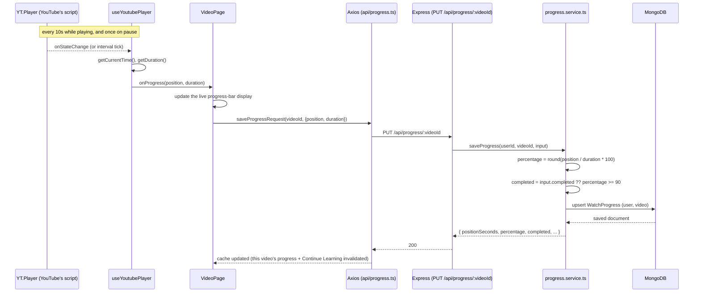

# Progress tracking

## What it does

Remembers how far into a video you've gotten, so returning to it resumes
playback where you left off instead of from the start, and marks a video
"completed" once you've watched most of it (automatically) or whenever
you say so yourself (manually).

## Why it exists

The whole premise of this product is a learning environment, not a
video player — and a learning environment that forgets where you were
every time you navigate away isn't one a student would actually use for
a multi-hour lecture series.

## User flow

1. Open a video. If you've watched it before, playback starts from your
   last position rather than 0:00.
2. Watch normally. Every ~10 seconds (and whenever you pause), your
   position is saved automatically — nothing to click.
3. A progress bar under the player shows how much you've watched.
4. Watching past 90% marks it completed automatically, or click
   **Mark complete** / **Mark incomplete** yourself at any time.
5. Anything in progress (started, not completed) shows up in **Continue
   Learning** on the dashboard.

## Data flow: saving progress while watching

Resuming is the mirror image, run once at page load: `VideoPage` fetches
existing progress *before* ever rendering `VideoPlayer`, and passes the
saved `positionSeconds` in as `startSeconds` — see
[12-video-player](../12-video-player/) for exactly why that ordering
matters.

## Frontend implementation

- `features/progress/hooks/useProgress.ts` — one video's saved progress
  (`null`, not an error, if never watched).
- `features/progress/hooks/useSaveProgress.ts` — the save mutation.
- `features/progress/hooks/useContinueLearning.ts` — the in-progress
  list, which both the dashboard and (indirectly, via the same cached
  query) the Progress section's count use.
- `pages/VideoPage.tsx` — orchestrates all three, plus a `useRef`
  tracking the most recently reported position for the **Mark complete**
  button to save against (see that file's comment on the one edge case
  this doesn't perfectly cover: clicking it before any playback has been
  reported at all).

**Why the live percentage isn't just `useProgress`'s data, re-read:**
`VideoPage` keeps a separate `useState` for the on-screen percentage,
updated directly by the player's `onProgress`/`onEnded` callbacks, rather
than re-reading the `useProgress` query after each autosave. If it
re-read the query, the *resume position* fed into `VideoPlayer` — also
sourced from that same query — would change after the player already
started, which `12-video-player` explains is specifically what `useYoutubePlayer`
is built to avoid.

## Backend implementation

- `models/WatchProgress.ts` — one document per `(user, video)`, unique
  index enforced at the database level, so "save progress" is always an
  upsert, never a risk of duplicate rows for the same video.
- `services/progress.service.ts` — the only place percentage and
  automatic completion are computed. Takes `positionSeconds` and the
  *player's own reported* `durationSeconds` (not `Video.durationSeconds`
  from the Data API) — what the percentage is actually computed against
  should be what the player itself measured, not a separately-fetched
  number that could in principle disagree with it.
- An explicit `completed` field in the request body overrides the
  automatic 90% threshold — this is how the Mark complete/incomplete
  button works, and the *only* way completion can go against the
  percentage (watched 95% but manually marked incomplete, or watched 10%
  and manually marked complete — both valid, both respected).

## Database representation

See `docs/09-mongodb`'s `WatchProgress` entry for the full schema.

## API

See `docs/14-api`'s Progress section for the three endpoints
(`GET /api/progress`, `GET /api/progress/:videoId`,
`PUT /api/progress/:videoId`) in full request/response detail.

## Edge cases handled

- **No progress yet** — `GET /api/progress/:videoId` returns
  `{ progress: null }`, a 200, not a 404: "never watched" is a normal
  state for a freshly imported video, not an error.
- **Video deleted from our database** (can't currently happen through any
  UI path, but the server doesn't trust that) — `saveProgress` checks the
  video exists before writing progress for it, returning 404 rather than
  creating an orphaned `WatchProgress` row pointing at nothing.
- **Position reported past duration** (can happen with a few hundred
  milliseconds of rounding slop from the player) — percentage is capped
  at 100, never shown as 103%.
- **A malformed video id in the URL** — validated and rejected with 400
  before it ever reaches a database query that would otherwise throw a
  less legible error.

## Testing

`server/tests/progress.test.ts` covers the percentage/completion math
directly (below threshold, at threshold, both manual overrides, the
100%-cap), the 404s, and that "no progress yet" is a 200 with `null`, not
an error. `client/src/features/videos/hooks/useYoutubePlayer.test.ts`
covers the interval timing (reports every 10s while playing, stops and
flushes once on pause) with fake timers. `client/src/pages/VideoPage.test.tsx`
covers the full resume → watch → save → display loop and the Mark
Complete button, with the player faked end to end.

## How to modify it

- **Change the autosave interval**: `PROGRESS_SAVE_INTERVAL_MS` in
  `useYoutubePlayer.ts`.
- **Change the completion threshold**: `COMPLETION_THRESHOLD_PERCENT` in
  `models/WatchProgress.ts` — used only by the backend, so this is the
  one place to change it.
- **Add a new field to what's saved**: add it to `WatchProgress.ts`,
  `watchProgress.repository.ts`'s `SaveProgressFields`,
  `progress.validators.ts`, and the `toPublicProgress` mapper in
  `progress.service.ts`.

## Possible improvements

- A live-updating percentage *while* playing (currently only updates on
  the ~10s save tick or on pause) — would need a separate, faster local
  poll that updates the display without necessarily hitting the server
  every time.
- Total learning time and streaks (Phase 9) — genuinely different from
  what's tracked here: this records a *position*, not accumulated watched
  *duration*, which re-watching or seeking around doesn't straightforwardly
  convert into "time spent learning".
