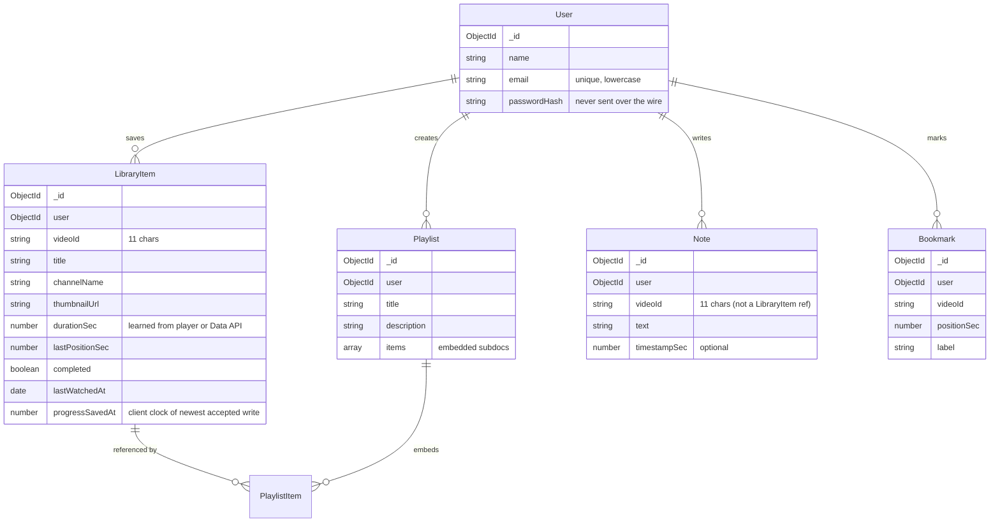

# API and Data Design

This document covers the database schemas, indexes, endpoint
contracts, ownership enforcement, validation rules, and the conflict
policy that makes offline replay safe. It is the deepest reference
for the data layer.

---

## 1. Collections at a Glance



The `PlaylistItem` shape is embedded inside `Playlist.items`, not a
top-level collection. See §3 for the reasoning.

---

## 2. Why These Collections

The guiding idea: **one document per real-world thing.** A
`LibraryItem` is one user's relationship with one YouTube video — it
is *not* the video itself (the video is on YouTube) and it is *not*
just a progress record. Combining metadata and progress into one
document means every page that lists saved videos can do it in one
query, with no join.

Notes and bookmarks are keyed by `(user, videoId)` rather than by a
`LibraryItem` reference. This is deliberate: you can take notes on a
video before saving it, and notes survive removing the video from your
library (they reappear if you re-save). Notes are *about the video*,
not *about the library entry*.

Bookmarks are a separate collection rather than a `kind` field on
notes, because the shape differs: a bookmark is `(positionSec, label)`,
a note is `(text, timestampSec?)`. Merging them would force
nullable-everything schemas or empty body fields on half the
documents.

---

## 3. Embedding vs. Referencing

### The decision: embed playlist items inside the playlist document

```js
items: [
  {
    libraryItem: { type: ObjectId, ref: 'LibraryItem', required: true },
    addedAt: { type: Date, default: Date.now },
  },
]
```

**Why embed:**

- A playlist entry has no life of its own. It has no fields beyond the
  reference and the added date. There is nothing you would query
  about a `PlaylistItem` directly — you always ask "which videos are
  in this playlist?".
- The detail view needs the whole list in one query
  (`Playlist.findOne(...).populate('items.libraryItem')`). With a
  separate collection you'd need a join (or two queries).
- Playlist progress is "how many member items have
  `completed: true`" — a one-liner over the embedded array.

**The trade-off — manual consistency:** when a video is removed from
the library, any playlist references to it must go too. The library
delete route does this with one `$pull` update:

```js
await Playlist.updateMany(
  { user: req.user._id },
  { $pull: { items: { libraryItem: item._id } } },
)
```

Without that, the playlist would contain dangling references. The
detail view's `toPlaylistDetail` filters them out defensively
(`.filter((i) => i.libraryItem)`), so even if a reference became
stale it wouldn't crash — but the explicit cleanup keeps the data
tidy.

**When you would switch to a separate collection:** if playlist
entries grew their own fields (per-entry notes, custom titles,
ordering metadata beyond `addedAt`), embedding would bloat the
playlist document. At that point promote `PlaylistItem` to its own
collection.

---

## 4. Indexes

| Model | Index | Purpose |
| --- | --- | --- |
| `User` | `{ email: 1 }` unique | login lookup, no duplicate accounts |
| `LibraryItem` | `{ user: 1, videoId: 1 }` unique | per-user dedup + fast lookup |
| `LibraryItem` | `{ user: 1 }` | list "my library" |
| `Playlist` | `{ user: 1 }` | list "my playlists" |
| `Note` | `{ user: 1, videoId: 1 }` | list "my notes for this video" |
| `Bookmark` | `{ user: 1, videoId: 1 }` | list "my bookmarks for this video" |

**Why these and not more:** indexes speed up reads but slow down
writes. Every index you add makes inserts/updates pay for keeping
the index in sync. The indexes above cover *exactly* the queries the
routes run:

```js
LibraryItem.findOne({ user: req.user._id, videoId })       // watch page
LibraryItem.find({ user: req.user._id })                  // library page
Note.find({ user: req.user._id, videoId }).sort({ createdAt: 1 })  // notes for a video
// …
```

**What is not indexed (and why):**

- `LibraryItem.lastWatchedAt` — the library page sorts by it
  client-side after fetching. The full list is small; an index would
  not help.
- `Note.createdAt` — sorting by `createdAt` per-video. Each user's
  notes for a video are typically a handful; no index needed.

---

## 5. Field Design Decisions

### 5.1 `LibraryItem.durationSec` — learned, not fetched

oEmbed doesn't return duration. So `durationSec` starts at `0` and is
filled in two ways:

1. From the player, on every progress write (`PATCH /library/:id/progress`).
2. From the Data API, when saving a video from a search result or
   playlist import (the Data API returns ISO-8601 durations, parsed
   by `parseISODuration`).

Why store it (rather than always fetching from the player)? Because
the library page wants to show "12:34" next to each video without
loading each one into a player. Once learned, it stays.

### 5.2 `LibraryItem.progressSavedAt` — the conflict rule

This is the field that makes offline replay safe. See §9 below.

### 5.3 `LibraryItem.progressPercent` — virtual, not stored

```js
libraryItemSchema.virtual('progressPercent').get(function () {
  if (this.completed) return 100
  if (!this.durationSec || !this.lastPositionSec) return 0
  return Math.min(100, Math.round((this.lastPositionSec / this.durationSec) * 100))
})
```

Why a virtual? Storing it would create a third field that has to stay
in sync with `lastPositionSec`, `durationSec`, and `completed`.
Computing on read keeps it correct by construction. The cost (a
JavaScript calculation per document on read) is negligible for a
personal library.

### 5.4 `User.passwordHash` — never in JSON

The `User.toJSON` transform strips `passwordHash` (and `_id` is
renamed to `id`). So even if a route accidentally returns `user` to
the client, no hash leaks. Verified by a test
(`server/tests/api.test.js`: "signup responses never leak the
password hash").

### 5.5 `Note.timestampSec` and `Bookmark.positionSec` — different shapes

- A note's `timestampSec` is *optional* — a note can be general
  ("the speaker's argument depends on a hidden assumption") without
  pointing at a moment.
- A bookmark's `positionSec` is *required* — a bookmark without a
  position is meaningless.

This is the core reason they are separate collections.

### 5.6 `Bookmark.positionSec` — rounded to whole seconds

```js
positionSec: Math.round(positionSec)
```

The duplicate guard looks for an existing bookmark at the same rounded
second. So clicking "bookmark" twice in quick succession returns the
existing bookmark (`alreadySaved: true`) instead of creating a
duplicate. The trade-off: you cannot have two bookmarks within the
same second of the same video — which is fine for the use case
("bookmark the moment the formula appears").

---

## 6. Endpoint Inventory

All endpoints are under `/api`. Endpoints marked 🔒 require
`Authorization: Bearer <token>`.

### 6.1 Auth — `server/src/routes/auth.js`

| Method | Path | Auth | Body / Query | Returns |
| --- | --- | --- | --- | --- |
| POST | `/auth/signup` | — | `{ name, email, password }` | `201 { token, user }` |
| POST | `/auth/login` | — | `{ email, password }` | `200 { token, user }` |
| GET | `/auth/me` | 🔒 | — | `200 { user }` |

**Validation:** name 2–80 chars, email matches `/^\S+@\S+\.\S+$/`,
password ≥ 8 chars. Per-field error messages on failure.

**No account enumeration:** unknown email and wrong password return
the same 401 message.

**Rate limit:** 20 req/min per IP, applied at the router level in
`app.js`.

### 6.2 Videos — `server/src/routes/videos.js`

| Method | Path | Auth | Query | Returns |
| --- | --- | --- | --- | --- |
| GET | `/videos/metadata` | 🔒 | `?url=<youtube url or video id>` | `200 { videoId, title, channelName, thumbnailUrl, [metadataUnavailable] }` |
| GET | `/videos/search` | 🔒 | `?q=<2–100 chars>` | `200 { results: [...], configured: true }` or `501 { configured: false }` |
| GET | `/videos/playlist` | 🔒 | `?url=<playlist url or id>` | `200 { playlist, configured: true }` or `501` |

**Validation:** `q` must be 2–100 chars (trimmed). URL must yield a
valid video/playlist id.

**Behavior:**
- Metadata: calls oEmbed with 10s timeout. 400/401/403/404 → 404 to
  client. Network failure → fallback metadata with
  `metadataUnavailable: true`.
- Search/playlist: returns `501 { configured: false }` if
  `YOUTUBE_API_KEY` is missing; otherwise calls the Data API and
  returns parsed results.

**Rate limit:** 10 req/min on search and playlist preview.

### 6.3 Library — `server/src/routes/library.js`

| Method | Path | Auth | Body / Query | Returns |
| --- | --- | --- | --- | --- |
| GET | `/library` | 🔒 | `?videoId=&q=&status=&sort=&page=&limit=` | `200 { items: [...] }` or paginated |
| POST | `/library` | 🔒 | `{ videoId, durationSec? }` | `201 { item, alreadySaved }` |
| PATCH | `/library/:itemId/progress` | 🔒 | `{ positionSec, durationSec?, completed?, savedAt? }` | `200 { item, stale? }` |
| DELETE | `/library/:itemId` | 🔒 | — | `200 { message }` |

**Query params on GET `/library`:**
- `?videoId=...` — single lookup used by the watch page; returns
  `{ item: <LibraryItem | null> }` instead of the list shape.
- `?q=...` — case-insensitive search in `title` + `channelName` (via
  `escapeRegex` to prevent RegExp injection).
- `?status=in-progress|completed|unwatched` — `in-progress` requires
  `completed: false, lastPositionSec > 0`; `unwatched` requires
  `completed: false, lastPositionSec <= 0`.
- `?sort=recently-watched|recently-added|title` (default
  `recently-watched`).
- `?page=&limit=` — paginated mode (1-based page, `limit` ≤ 100).
  Without `limit`, every matching item is returned (used by the
  dashboard).

**POST behavior:** re-validates the id server-side, fetches oEmbed
metadata, dedupes against the user's existing entry. If a known
`durationSec` is supplied (Data API path), backfills the duration
onto an existing item that never learned one.

**DELETE behavior:** removes from library *and* `$pull`s the item
from any playlists that reference it (manual consistency, see §3).

### 6.4 Playlists — `server/src/routes/playlists.js`

| Method | Path | Auth | Body | Returns |
| --- | --- | --- | --- | --- |
| GET | `/playlists` | 🔒 | — | `200 { playlists: [summaries] }` |
| POST | `/playlists` | 🔒 | `{ title, description? }` | `201 { playlist }` |
| POST | `/playlists/import` | 🔒 | `{ url, title? }` | `201 { playlist, imported, alreadySaved, truncated }` |
| GET | `/playlists/:id` | 🔒 | — | `200 { playlist: detail }` |
| PATCH | `/playlists/:id` | 🔒 | `{ title?, description? }` | `200 { playlist }` |
| DELETE | `/playlists/:id` | 🔒 | — | `200 { message }` |
| POST | `/playlists/:id/items` | 🔒 | `{ libraryItemId }` | `201 { playlist, alreadyInPlaylist }` |
| PATCH | `/playlists/:id/items/order` | 🔒 | `{ order: [entryId, …] }` | `200 { playlist }` |
| DELETE | `/playlists/:id/items/:itemId` | 🔒 | — | `200 { playlist }` |

**Validation:**
- Title 1–100 chars, description ≤ 300 chars.
- `order` must be a permutation of the current entry ids (every entry
  exactly once). Rejects partial reorders.

**Import behavior:** calls `fetchYouTubePlaylist` (Data API), takes
the first 50 videos, saves each to the library (dedupes against
already-saved videos), collects them into a new local playlist.
Returns `imported` (new saves), `alreadySaved` (reused), and
`truncated: true` if the source had > 50 videos.

**Rate limit:** 5 req/min on import.

### 6.5 Notes — `server/src/routes/notes.js`

| Method | Path | Auth | Body | Returns |
| --- | --- | --- | --- | --- |
| GET | `/notes?videoId=...` | 🔒 | — | `200 { notes }` (oldest first) |
| POST | `/notes` | 🔒 | `{ videoId, text, timestampSec? }` | `201 { note }` |
| PATCH | `/notes/:id` | 🔒 | `{ text?, timestampSec? }` | `200 { note }` |
| DELETE | `/notes/:id` | 🔒 | — | `200 { message }` |

**Validation:** `videoId` must parse to an 11-char id; `text` 1–2000
chars (trimmed); `timestampSec` non-negative number or null.

### 6.6 Bookmarks — `server/src/routes/bookmarks.js`

| Method | Path | Auth | Body | Returns |
| --- | --- | --- | --- | --- |
| GET | `/bookmarks?videoId=...` | 🔒 | — | `200 { bookmarks }` (per-video: by position; all: by recency) |
| POST | `/bookmarks` | 🔒 | `{ videoId, positionSec, label? }` | `201 { bookmark, alreadySaved }` |
| PATCH | `/bookmarks/:id` | 🔒 | `{ label?, positionSec? }` | `200 { bookmark }` |
| DELETE | `/bookmarks/:id` | 🔒 | — | `200 { message }` |

**Validation:** `videoId` matches `/^[A-Za-z0-9_-]{11}$/`;
`positionSec` non-negative number; `label` ≤ 120 chars.

**Duplicate guard:** posting a second bookmark for the same rounded
second of the same video returns the existing one with
`alreadySaved: true`.

### 6.7 Stats — `server/src/routes/stats.js`

| Method | Path | Auth | Returns |
| --- | --- | --- | --- |
| GET | `/stats` | 🔒 | `200 { videos, playlists, notes, bookmarks, estimatedMinutes, remainingMinutes, activity, streakDays, unfinishedPlaylists }` |

Computed, not stored. See §10.

---

## 7. Request/Response Shapes

Every response is JSON. Two shapes:

**Success** — the data the route returns, e.g. `{ item, alreadySaved }`.

**Error** — `{ message: string, fields?: { [field]: string } }`. The
client's `ApiError` reads both.

The central error handler (`server/src/middleware/errorHandler.js`)
produces the error shape from three sources:

1. `httpError(status, message, fields?)` thrown by a route handler —
   passes through.
2. Mongoose `ValidationError` — turned into a 400 with `fields`
   populated from `err.errors[path].message`.
3. Mongoose `CastError` (malformed ObjectId) — turned into a clean
   400.

For unexpected errors (5xx): the handler logs the details server-side
and returns a generic `"Something went wrong on our side."`. Stack
traces never leak to the client.

---

## 8. Ownership Enforcement

Every query in protected routes includes `user: req.user._id`. This
makes cross-user access a non-event — the document simply is not
found:

```js
// server/src/routes/library.js
const item = await LibraryItem.findOne({
  _id: req.params.itemId,
  user: req.user._id,        // ← ownership filter
})
if (!item) throw httpError(404, 'Video not found in your library.')
```

List endpoints (`GET /library`, `GET /playlists`, etc.) filter by
`user: req.user._id` so they return only the caller's data — never
another user's. Cross-user isolation is verified by an integration
test that creates a second account and asserts every read/edit/delete
of user A's resources from user B returns 404 (or empty arrays for
list endpoints).

**The client never sends its own user id.** Identity always comes from
the verified token (`req.user`). Even if a malicious client sent
`{ user: someoneElseId }` in the body, the route would ignore it
(most routes don't even read `req.body.user`); the user comes from
the token, period.

---

## 9. The `savedAt` Conflict Rule

This is the single most important data-design decision in the app.
Read this twice.

### The problem

Progress writes happen ~every 10 seconds while watching. If the
network fails mid-watch, the writes are queued in IndexedDB. When
the network returns, they're replayed. Without protection, an old
queued write could clobber newer progress the user made online in
the meantime.

### The rule

Every progress PATCH may carry `savedAt` — a millisecond timestamp
from the **client's clock**. The server keeps `progressSavedAt` on
the `LibraryItem` (default `0`).

> If the request's `savedAt` is **not newer** than the stored
> `progressSavedAt`, the write is a duplicate or a stale replay: keep
> the stored state and answer `{ item, stale: true }`.

### Why client clocks (and not server timestamps)?

If the server stamped writes on receipt, a queued write replayed
hours later would arrive "now", appear newest, and clobber progress
the user made online in between. With client timestamps, the replay
carries the original moment and the server ignores it.

### What the rule buys

- **Retries are idempotent.** Sending the same request twice = one
  update. The second response says `stale: true`.
- **Offline replay is safe.** The queue replays in order; the server
  keeps only the newest.
- **Deliberate rewinds still work** (Start Over button), because they
  carry a *newer* `savedAt` than the previous write.

### Honest limitations (single-user app)

- Two devices with skewed clocks can misorder writes (rare, harmless
  here).
- Simultaneous playback on two devices is last-writer-wins among newer
  writes; the UI does not resolve per-second conflicts.
- Requests without `savedAt` always apply (the live path before
  offline support was added). The client always sends `savedAt` now,
  but the server tolerates its absence for backward compatibility.

### Where to read the code

- `LibraryItem.progressSavedAt` field — `server/src/models/LibraryItem.js`
- Conflict check + ignore branch — `server/src/routes/library.js`,
  `PATCH /:itemId/progress`
- Queue + replay — `client/src/lib/offline.js`,
  `client/src/lib/api.js#flushProgressQueue`

The full lifecycle (player → throttle → PATCH → server rule →
response) is diagrammed in [`progress-sync.md`](progress-sync.md)
and walked through in
[`feature-walkthroughs.md`](feature-walkthroughs.md#3-watch-and-progress-tracking).

---

## 10. Statistics: Computed, Not Stored

There is no `Stat` collection. `GET /api/stats` folds the user's
existing `LibraryItem`/`Playlist`/`Note`/`Bookmark` documents in plain
JavaScript on every request.

### Why compute on read

- Numbers cannot drift from the source data.
- A personal library is dozens of documents, not millions. The fold
  is sub-millisecond.
- Stats recompute on read — exactly what you want after every progress
  update anyway.

### Honest metric definitions (mirrored in the UI)

| Field | What it actually means |
| --- | --- |
| `videos.saved` | Count of `LibraryItem` documents for this user. |
| `videos.completed` | Count where `completed: true`. |
| `videos.inProgress` | Count where `completed: false` and `lastPositionSec > 0`. |
| `estimatedMinutes` | **Position-based estimate, not measured watch time.** For completed videos, the full `durationSec`. For in-progress, the `lastPositionSec`. An approximation of how much of the content you have been through. |
| `remainingMinutes` | Sum of `durationSec - lastPositionSec` for in-progress videos. |
| `activity[].count` | Number of videos whose `lastWatchedAt` falls on that day. A video watched across several days counts once, on the latest day. |
| `streakDays` | Consecutive days with activity, ending today or yesterday. |
| `unfinishedPlaylists` | Top 4 playlists with at least one unwatched item, sorted by completion %. Each includes the `next` video to watch. |

The label "estimated" is intentional. We do not measure actual
seconds-watched (the YouTube IFrame API does not expose that), so the
numbers are an honest approximation, not a fabricated metric.

### When you would switch to an aggregation pipeline

For thousands of documents per user, fetching them all into JS would
be slow. An aggregation pipeline (`$group`, `$match`, etc.) running
on MongoDB would be the right move. For this app, the JS fold is
clearer and fast enough.

---

## 11. Validation Rules — Where They Live

Validation is per-route, not per-model (with a few exceptions). The
pattern:

```js
const fields = {}
if (!name || name.trim().length < 2) fields.name = 'Enter your name (at least 2 characters).'
if (!email || !EMAIL_RE.test(email.trim())) fields.email = 'Enter a valid email address.'
if (!password || password.length < MIN_PASSWORD_LENGTH) fields.password = '...'
if (Object.keys(fields).length > 0) {
  throw httpError(400, 'Please check the highlighted fields.', fields)
}
```

**Why per-route:** the route is the only place that knows what the
request shape should be. Pushing validation into Mongoose schemas
would couple validation rules to the data shape (e.g. "password ≥ 8
chars" is a request-level concern, not a storage-level one).

**Where Mongoose validation does apply:** `required`, `maxlength`,
`min`, and `match` validators on schema fields are a backstop — they
catch anything that slips past the route-level check and produce a
`ValidationError` the central handler converts to a 400 with `fields`.

### Bounds enforced (a sample)

- `User.name`: 2–80 chars
- `User.email`: matches `/^\S+@\S+\.\S+$/`
- `password` (signup): ≥ 8 chars
- `Playlist.title`: 1–100 chars
- `Playlist.description`: ≤ 300 chars
- `Note.text`: 1–2000 chars
- `Bookmark.label`: ≤ 120 chars
- `Bookmark.positionSec`: ≥ 0
- `LibraryItem.durationSec`: 0 ≤ x ≤ 48h (clamped)
- Search query: 2–100 chars

### NoSQL injection protection

User input is never interpolated into query objects as raw objects —
values are compared as typed scalars (`findOne({ videoId: String(videoId) })`).
Express's `express.json` produces plain objects that Mongoose casts
against the schema. The one place input becomes a `RegExp` (library
search) runs through `escapeRegex` first:

```js
function escapeRegex(str) {
  return str.replace(/[.*+?^${}()|[\]\\]/g, '\\$&')
}
```

---

## 12. Pagination

Server-side pagination is implemented on `GET /api/library` but
**not used by the client**. The library page fetches the full list
once and filters client-side.

### Why

- A personal library is small (dozens of videos).
- Client-side filtering makes tab counts instant (no per-filter
  request).
- The server offers `?page=&limit=` for API consumers who need
  pagination.

### When you would switch to server-side pagination on the client

If the library grew to thousands of videos, client-side filtering
would block the main thread. At that point switch to `?page=&limit=`
and refetch on filter change.

---

## 13. The Request Lifecycle (one example, end-to-end)

A full trace of **saving a video** is in
[`request-lifecycle.md`](request-lifecycle.md) with a sequence
diagram. The short version:

1. User clicks "Save to library" → `Watch.jsx#saveToLibrary()`.
2. `api('/library', { method: 'POST', body: { videoId } })`.
3. `api()` adds Bearer header, JSON-encodes body, `fetch`es
   `/api/library` (relative URL, same-origin).
4. Vite dev server proxies `/api/library` → `http://localhost:4000/api/library`.
5. Express runs `cors` → `express.json` → `nosniff` headers → router.
6. Router runs `requireAuth` (verifies JWT, loads user, sets `req.user`).
7. Handler validates input (`extractVideoId`), checks for an existing
   item (`LibraryItem.findOne({ user, videoId })`).
8. If new, calls `fetchVideoMetadata(videoId)` (oEmbed, 10s timeout).
9. Creates `LibraryItem` with the user's id and metadata.
10. Returns `201 { item, alreadySaved: false }`.
11. `api()` parses JSON, throws `ApiError` if non-2xx, otherwise
    returns the data.
12. `Watch.jsx` calls `setLibraryItem(item)`, React re-renders the
    action row ("In your library" + Add to playlist / Remove), toast
    fires.

Eight more lifecycles are walked through in
[`feature-walkthroughs.md`](feature-walkthroughs.md).

---

Next: [`feature-walkthroughs.md`](feature-walkthroughs.md) traces each
major feature end-to-end.
