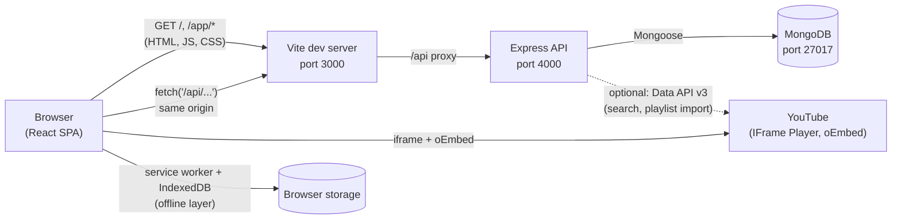
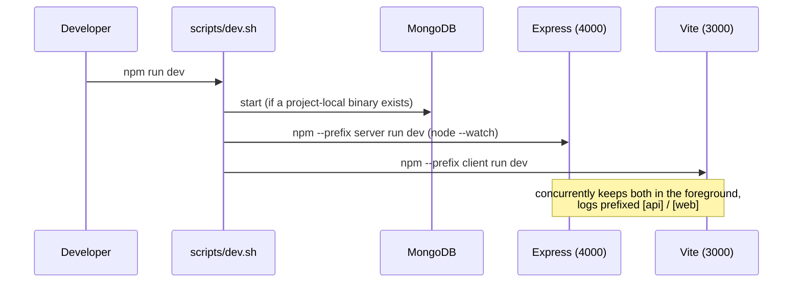

# Architecture

This document explains how the pieces of **No Distractions** fit together, why
they are arranged this way, and where the important code lives.

## The Big Picture



Three processes run during development (`scripts/dev.sh` starts all of them):

1. **Vite dev server** (`client/`, port 3000) — serves the React app and
   proxies every `/api/*` request to the API. Because the browser only ever
   talks to port 3000, there are no CORS headaches during development.
2. **Express API** (`server/`, port 4000) — a JSON REST API. It validates
   input, checks authentication and ownership, and reads/writes MongoDB.
   When a `YOUTUBE_API_KEY` is configured it also proxies search and
   playlist-import requests to the official Data API (see
   [`docs/youtube-integration.md`](youtube-integration.md)).
3. **MongoDB** (port 27017) — the only persistent store on the server.

The YouTube iframe is embedded directly by the browser and talks to YouTube
itself — our servers never proxy or transform video traffic. The browser
also has a small offline layer (service worker + IndexedDB) that caches the
app shell and queues progress writes — see
[`docs/offline-support.md`](offline-support.md).

## Why This Shape

**One API, one SPA, one database.** For an MVP of this size, a separate
controller/service/repository layer per resource would add files without
adding clarity. Instead, each resource has one route file that contains its
HTTP logic, and one Mongoose model that contains its data logic:

- Routes: [`server/src/routes/`](../server/src/routes/) — `auth.js`,
  `videos.js`, `library.js`, `playlists.js`, `notes.js`, `bookmarks.js`,
  `stats.js`
- Models: [`server/src/models/`](../server/src/models/) — `User.js`,
  `LibraryItem.js`, `Playlist.js`, `Note.js`, `Bookmark.js`

Cross-cutting concerns live in middleware:

- [`server/src/middleware/auth.js`](../server/src/middleware/auth.js) —
  verifies JWTs and attaches `req.user`
- [`server/src/middleware/rateLimit.js`](../server/src/middleware/rateLimit.js) —
  small fixed-window limiter on auth and Data API endpoints
- [`server/src/middleware/errorHandler.js`](../server/src/middleware/errorHandler.js) —
  one central error handler that maps known error shapes to safe responses

The HTTP application is created in
[`server/src/app.js`](../server/src/app.js), separate from the startup in
`index.js` — that split is what lets the test suite boot the real app
in-process (see [`docs/testing.md`](testing.md)).

**Express 5 note:** Express 5 automatically forwards errors thrown in
`async` route handlers to the error middleware, so routes can simply
`throw httpError(404, '…')` without try/catch wrappers
([`server/src/utils/errors.js`](../server/src/utils/errors.js)).

## Frontend Organization

The client is a standard Vite + React SPA with React Router:

```
client/src/
├── main.jsx            # providers, router mount, service worker registration
├── App.jsx             # route table, public vs protected routes
├── lib/api.js          # fetch wrapper: auth header, JSON, error shaping,
│                       #   offline cache fallback + progress queue
├── lib/offline.js      # IndexedDB: read cache + progress write queue
├── lib/youtube.js      # client-side URL parsing (instant feedback)
├── context/            # AuthContext (session), ToastContext (feedback)
├── components/         # AppLayout, YouTubePlayer, WatchSidebar, …
├── pages/              # one file per route
└── public/sw.js        # service worker (production builds only)
```

Three ideas worth knowing:

- **Server state lives in pages, not a global store.** Each page fetches
  what it needs with the small `api()` wrapper and holds it in `useState`.
  For an app of this size that is easier to read than a caching layer.
  (`AuthContext` is the exception: the session is truly global.)
- **The YouTube player is isolated in one component.**
  [`client/src/components/YouTubePlayer.jsx`](../client/src/components/YouTubePlayer.jsx)
  is the only place that touches the IFrame Player API, so the rest of the
  app works with plain callbacks (`onProgress`, `onEnded`, `onError`).
- **Offline behavior is isolated in two modules.**
  [`client/src/lib/offline.js`](../client/src/lib/offline.js) owns all
  IndexedDB access and [`client/public/sw.js`](../client/public/sw.js)
  owns static caching; nothing else in the app knows about browsers being
  offline except the `OfflineBanner`.

## Development Workflow



`node --watch` restarts the API when server files change; Vite hot-reloads the
client. Nothing else is needed.

## Deploying Later (Not Part of the MVP)

The same shape maps cleanly to production: `npm run build` in `client/`
produces static files in `client/dist/`, which any static host (or the Express
server itself, via `express.static`) can serve, while the API runs behind
HTTPS with a real `MONGO_URI`. The Vite proxy is development-only
configuration — in production you would serve the built client and the API
from the same origin or configure CORS for the client's origin.
