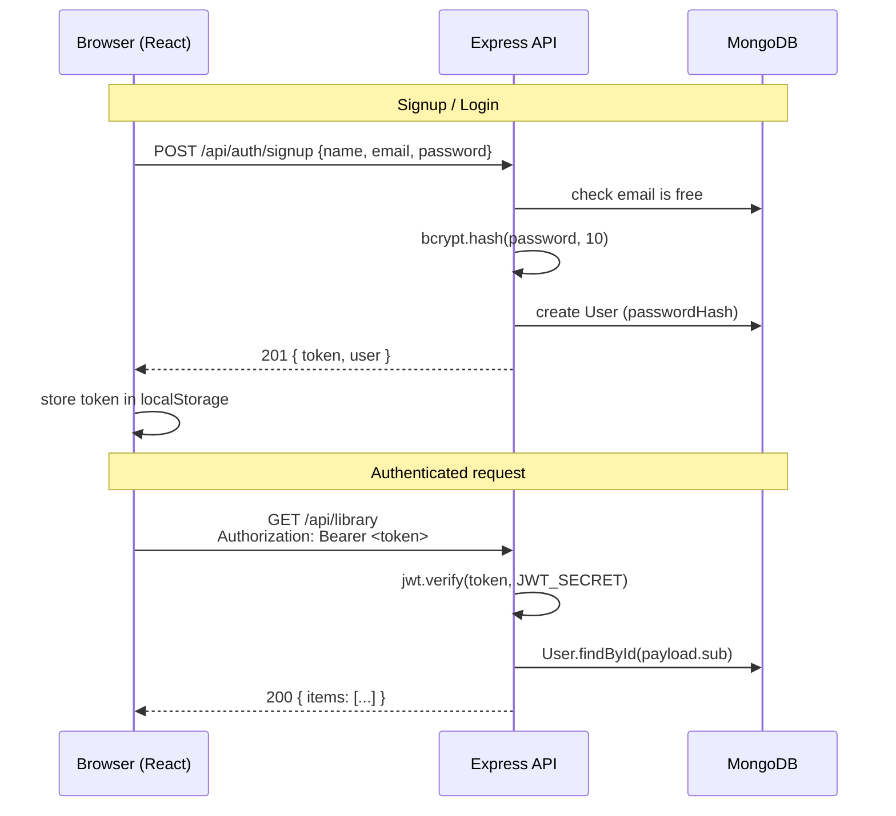

# Authentication

No Distractions uses **stateless JWT authentication** with hashed passwords —
the classic MERN approach: no session store, no cookies, one secret.

## Why JWT and Not Sessions

- The API is a pure JSON API consumed by an SPA; there are no server-rendered
  pages that would benefit from cookie sessions.
- A token in the `Authorization` header works identically through the Vite
  dev proxy and in a future deployed setup.
- The trade-off is accepted knowingly: tokens are stored in `localStorage`
  on the client, which means a successful XSS attack could read them. For an
  MVP without third-party scripts this is the standard, reasonable choice;
  an httpOnly-cookie variant is listed in the README as a future hardening
  step.

## Flow



## The Pieces

| Concern              | Code                                                              |
| -------------------- | ----------------------------------------------------------------- |
| Password hashing     | `bcryptjs`, 10 rounds — `server/src/routes/auth.js`               |
| Token creation       | `signToken(user)` — `server/src/middleware/auth.js`               |
| Token verification   | `requireAuth` middleware — `server/src/middleware/auth.js`         |
| Client session state | `AuthContext` — `client/src/context/AuthContext.jsx`              |
| Request auth header  | `api()` wrapper — `client/src/lib/api.js`                          |

### Token contents

The token carries only the user id (`sub` claim) and an expiry:

```js
jwt.sign({ sub: user._id.toString() }, JWT_SECRET, {
  expiresIn: process.env.JWT_EXPIRES_IN || '7d',
})
```

The `requireAuth` middleware verifies the signature, loads the user fresh
from the database (so deleting an account invalidates its tokens), and
attaches the document to `req.user` for the route:

```js
const user = await User.findById(payload.sub)
if (!user) throw httpError(401, 'This account no longer exists.')
req.user = user
```

Routes opt in per router: `router.use(requireAuth)` at the top of the
library, playlists, and notes routers protects every route below it at once.

## Client Side

`AuthContext` restores the session on app start: if a token exists in
`localStorage`, it calls `GET /api/auth/me` to verify it and load the user.
If any later request returns 401 (expired token), the `api()` wrapper fires a
global `nd:unauthorized` event and the context drops the token — the
`RequireAuth` route guard then redirects to `/login`.

The guard itself is a tiny component in `client/src/context/AuthContext.jsx`:

```jsx
export function RequireAuth({ children }) {
  const { user, ready } = useAuth()
  if (!ready) return <Spinner /* full screen */ />
  if (!user) return <Navigate to="/login" replace />
  return children
}
```

`ready` matters: without it, a page refresh on a protected route would
redirect to login *before* the stored token had been verified.

## Error Behavior

- Wrong email or wrong password produce the **same** 401 message
  ("Incorrect email or password.") so the API cannot be used to probe which
  emails are registered.
- Validation failures return 400 with a `fields` object the forms render
  inline next to the offending input.
- The JWT secret is read from `server/.env` (gitignored); the server refuses
  to start without one.

## Phase 2 Additions

Two protections now wrap the flow described above:

- **Rate limiting** — `/api/auth/*` allows 20 requests per minute per IP
  ([`server/src/middleware/rateLimit.js`](../server/src/middleware/rateLimit.js)).
  Repeated failures end in a 429 with `Retry-After`, which blunts
  brute-force attempts and password-guessing scripts. The counter is
  in-process memory: one API instance, one counter (limits documented in
  [`security.md`](security.md)).
- **Offline session restore** — when `GET /auth/me` fails because the
  *network* is unreachable (not because the token is invalid),
  `AuthContext` keeps the session using a profile mirrored in
  `localStorage`, instead of mistaking a dead connection for an expired
  token. The token is re-verified the next time the app loads online.
