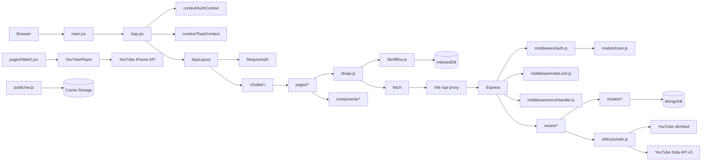

# Codebase Walkthrough

A folder-by-folder tour of the repository, anchored to real file paths
and function names. For each significant file: what it does, why it
exists, what calls it, what it calls, and what would go wrong if too
much logic moved into it.

```
no-distractions/
├── client/                  # React frontend (Vite)
├── server/                  # Express API
├── scripts/                 # dev orchestrator + smoke tests
├── docs/                    # this documentation set
├── README.md
├── package.json            # root orchestrator
└── .gitignore
```

---

## 1. `server/` — the Express API

```
server/
├── src/
│   ├── app.js              # the Express application
│   ├── index.js            # startup: connect DB, listen
│   ├── config/db.js        # Mongoose connection helper
│   ├── middleware/
│   │   ├── auth.js         # JWT sign + verify, requireAuth
│   │   ├── errorHandler.js # central error + 404 handlers
│   │   └── rateLimit.js    # fixed-window in-memory limiter
│   ├── models/
│   │   ├── User.js
│   │   ├── LibraryItem.js
│   │   ├── Playlist.js
│   │   ├── Note.js
│   │   └── Bookmark.js
│   ├── routes/
│   │   ├── auth.js
│   │   ├── videos.js
│   │   ├── library.js
│   │   ├── playlists.js
│   │   ├── notes.js
│   │   ├── bookmarks.js
│   │   └── stats.js
│   └── utils/
│       ├── errors.js       # httpError() helper
│       └── youtube.js      # URL parsing, oEmbed, Data API v3
├── tests/
│   ├── api.test.js         # integration tests (node:test)
│   ├── youtube-utils.test.js
│   └── helpers.js           # fake YouTube fetch, test DB
├── .env.example
└── package.json
```

### 1.1 `server/src/app.js` — the Express application

**Responsibility:** wire middleware and routers in the correct order.
**Why it is separate from `index.js`:** so the test suite can import
the app, boot it on an ephemeral port, and run real HTTP requests
without spawning a process or touching the production port. See
[`testing.md`](testing.md).

```js
const app = express()
app.set('trust proxy', 1)
app.use(cors({ origin: process.env.CLIENT_ORIGIN || 'http://localhost:3000' }))
app.use(express.json())
app.use((req, res, next) => {
  res.set('X-Content-Type-Options', 'nosniff')
  res.set('Referrer-Policy', 'no-referrer')
  next()
})
app.get('/api/health', (req, res) => res.json({ status: 'ok' }))
app.use('/api/auth', rateLimit({ max: 20, windowMs: 60_000, ... }), authRoutes)
app.use('/api/videos', videosRoutes)
// … other routers
app.use(notFoundHandler)
app.use(errorHandler)
```

**What calls it:** `server/src/index.js` (`app.listen(PORT)`).
**What it calls:** every router and middleware.
**What would go wrong if too much logic moved here:** app.js should
stay declarative — middleware + router mounting only. Business logic
in `app.js` becomes hard to test (you'd have to boot the app to test
it) and hard to find (developers look in `routes/` for handlers).

### 1.2 `server/src/index.js` — startup

**Responsibility:** load env vars, connect to MongoDB, listen on the
configured port. **Why separate:** app.js is import-safe (no side
effects); index.js has side effects (DB connect, listen).

### 1.3 `server/src/config/db.js` — Mongoose connection

**Responsibility:** set `strictQuery`, attach connection event
listeners, call `mongoose.connect`.

```js
export async function connectDatabase(uri) {
  mongoose.set('strictQuery', true)
  mongoose.connection.on('connected', () => console.log('[db] Connected to MongoDB'))
  mongoose.connection.on('error', (err) => console.error('[db] MongoDB connection error:', err.message))
  mongoose.connection.on('disconnected', () => console.warn('[db] Disconnected from MongoDB'))
  await mongoose.connect(uri)
}
```

**Why `strictQuery: true`:** prevents silent acceptance of query
fields that don't exist on the schema. Without it, typos in
`findOne({ usr: req.user._id })` would silently return null instead
of erroring — a class of bug that is very hard to find.

### 1.4 `server/src/middleware/auth.js` — JWT auth

**Responsibility:** two exports — `signToken(user)` (used by
`routes/auth.js` on login/signup) and `requireAuth(req, res, next)`
(used as middleware on every protected router).

**Why a separate file:** auth is the most cross-cutting concern in
the app. Having it in one file means one place to audit for security,
one place to change the token format, one place to add refresh tokens
later.

**What would go wrong if too much logic moved here:** `auth.js` should
stay focused on identity ("who is this user?"). Authorization ("is this
user allowed to do X?") lives in route handlers as ownership filters —
mixing the two would conflate "is the token valid" with "does this
user own this resource" and make both harder to reason about.

The "user re-fetched on every request" decision is in
`requireAuth`: a deleted account's tokens stop working immediately. At
scale you might cache the user for a few seconds; we don't, because
the cost of one extra `User.findById` is small for a personal app.

### 1.5 `server/src/middleware/errorHandler.js`

**Responsibility:** convert thrown errors to JSON responses. Three
cases:

- Mongoose `ValidationError` → 400 with `fields` per invalid path.
- Mongoose `CastError` (malformed ObjectId) → 400.
- Anything else: if `err.status` is 4xx, return that; otherwise log
  details server-side and return generic 500.

**Why central:** every route can just `throw httpError(400, ...)` and
the handler converts it. Without this, every route would need a
`try/catch` and the response shape would drift.

**What would go wrong if route handlers caught their own errors:**
inconsistent error shapes, leaked stack traces, duplicated logic.

### 1.6 `server/src/middleware/rateLimit.js`

**Responsibility:** a fixed-window, in-memory rate limiter. Factory
function `rateLimit({ windowMs, max, message })` returns middleware.

**Why hand-rolled:** the policy is simple — one Map of IP → count, a
sweep when the map grows past 1000 entries. `express-rate-limit`
would add a dependency for ~45 lines we control. The trade-off is
documented: the counter is in-process; multi-instance deployments
would need a shared store (Redis).

**Where it is used:**
- `/api/auth/*` → 20/min (bcrypt cost + brute-force target)
- `/api/videos/search`, `/api/videos/playlist` → 10/min (each search
  costs 100 Data API quota units)
- `/api/playlists/import` → 5/min

### 1.7 `server/src/models/` — Mongoose schemas

One file per collection. Each file:

- Declares the schema (fields, types, defaults, validators).
- Declares indexes (compound unique, single-field).
- Optionally declares virtuals (computed read-only fields).
- Sets a `toJSON` transform that strips `_id` (renamed to `id`),
  `__v`, and `passwordHash` (User only).

**Why one file per model:** the model is the source of truth for the
data shape. Co-locating the schema, indexes, and JSON transform means a
developer changing the data shape changes one file.

Detailed notes on each model are in
[`api-and-data-design.md`](api-and-data-design.md) and
[`database-models.md`](database-models.md).

### 1.8 `server/src/routes/` — route handlers

One file per resource. Each router:

- Mounts `requireAuth` at the top (`router.use(requireAuth)`) — every
  route below is protected.
- Validates input per route, throwing `httpError(400, msg, fields)`.
- Queries the model with an ownership filter (`{ user: req.user._id }`).
- Returns JSON.

**Why "fat routes" instead of separate controllers/services:** for the
current size, splitting `routes/library.js` (255 lines) into
`routes/library.js` + `controllers/library.js` + `services/library.js`
would triple the file count without clarifying anything. The route
handler *is* the controller. If the app grew, the natural split would
be "route handlers do HTTP (parse, validate, respond); services do
domain logic (the savedAt conflict rule, the import dedup, the stats
computation)." Right now those domain rules are short enough to live
inline; the savedAt rule is the only one extracted (into a comment
block — it's small enough).

**What would go wrong if route handlers grew to 1000+ lines:** they
would become untestable without booting the app, and the HTTP-shape
code would drown out the domain logic. At that point extract
services.

### 1.9 `server/src/utils/errors.js`

```js
export function httpError(status, message, fields) {
  const err = new Error(message)
  err.status = status
  if (fields) err.fields = fields
  return err
}
```

**Why a helper:** throwing `httpError(404, 'Not found')` is more
readable than `const e = new Error('Not found'); e.status = 404;
throw e`. The shape is uniform: a thrown Error with `.status` and
optional `.fields` is exactly what the central error handler
expects.

### 1.10 `server/src/utils/youtube.js`

**Responsibility:** everything that talks to YouTube.

- `extractVideoId(input)` — accepts every common YouTube URL form
  (watch, youtu.be, shorts, embed, live, bare id) and returns the
  11-character id or null.
- `fetchVideoMetadata(videoId)` — calls the public oEmbed endpoint
  with a 10-second timeout. Returns `{ title, channelName, thumbnailUrl }`
  or null when the video is unavailable (400/401/403/404).
- `thumbnailFor(videoId)` — the documented `i.ytimg.com/vi/<id>/hqdefault.jpg`
  pattern.
- `isYouTubeApiConfigured()` — `Boolean(process.env.YOUTUBE_API_KEY)`.
- `searchYouTubeVideos(query)` — Data API v3 `search.list` + a follow-up
  `videos.list` to fill in durations. 100 + 1 quota units per call.
- `fetchYouTubePlaylist(playlistId)` — `playlists.list` + `playlistItems.list`
  (first 50) + one `videos.list`. 1 + 1 + 1 quota units.
- `parseISODuration(iso)` — turns `"PT1H2M3S"` into `3725`.

**Why a separate file:** YouTube integration is compliance-sensitive
(no scraping, no downloading, only documented endpoints). One file is
the audit surface — anyone reviewing the project for compliance reads
this one file.

**What calls it:** `routes/videos.js` (metadata, search, playlist
preview), `routes/library.js` (oEmbed when saving), `routes/playlists.js`
(import). The client mirrors the URL parsing in
`client/src/lib/youtube.js` for instant feedback, but the server is
always the source of truth.

### 1.11 `server/tests/`

- `helpers.js` — boots the real Express app from `src/app.js` against
  a per-test-file MongoDB database; stubs `globalThis.fetch` with a
  fake YouTube (canned oEmbed + Data API responses).
- `api.test.js` — 30 integration tests covering auth, library +
  progress sync rules, playlists + reorder + import-dedup, notes,
  bookmarks, cross-user isolation, stats, rate limiting.
- `youtube-utils.test.js` — pure unit tests for URL parsing and ISO
  duration parsing.

**Why in-process:** spawning a process per test is slow and harder to
debug. Booting the app in-process against a real test DB (with
collections wiped between tests) gives real HTTP behavior without
process overhead. See [`testing.md`](testing.md).

---

## 2. `client/` — the React frontend

```
client/
├── public/
│   ├── sw.js               # service worker (production only)
│   └── favicon.svg
├── src/
│   ├── main.jsx            # mounts <App/>, registers SW in prod
│   ├── App.jsx             # route table
│   ├── index.css           # Tailwind + a few component classes
│   ├── context/
│   │   ├── AuthContext.jsx
│   │   └── ToastContext.jsx
│   ├── lib/
│   │   ├── api.js          # fetch wrapper + offline fallbacks
│   │   ├── offline.js      # IndexedDB read cache + progress queue
│   │   ├── youtube.js      # client-side URL parsing
│   │   └── format.js       # duration + relative time formatters
│   ├── components/
│   │   ├── AppLayout.jsx
│   │   ├── YouTubePlayer.jsx
│   │   ├── WatchSidebar.jsx
│   │   ├── NotesSection.jsx
│   │   ├── BookmarksSection.jsx
│   │   ├── PlaylistPanel.jsx
│   │   ├── AddToPlaylistModal.jsx
│   │   ├── VideoCard.jsx
│   │   ├── UrlInputForm.jsx
│   │   ├── OfflineBanner.jsx
│   │   └── common.jsx       # Spinner, Modal, EmptyState, ErrorState, StatusBadge
│   └── pages/
│       ├── Landing.jsx
│       ├── Login.jsx
│       ├── Signup.jsx
│       ├── AuthShared.jsx   # shared field-error form helpers
│       ├── Dashboard.jsx
│       ├── Watch.jsx
│       ├── Library.jsx
│       ├── Playlists.jsx
│       ├── PlaylistDetail.jsx
│       ├── Search.jsx
│       ├── Stats.jsx
│       └── NotFound.jsx
├── index.html
├── vite.config.js
└── package.json
```

### 2.1 `client/src/main.jsx` — entry point

Mounts `<App/>` inside `React.StrictMode`, imports Tailwind CSS, and
registers the service worker **only in production builds**. In dev the
SW would conflict with Vite's HMR (stale cached modules).

### 2.2 `client/src/App.jsx` — route table

```jsx
<AuthProvider>
  <ToastProvider>
    <BrowserRouter>
      <Routes>
        <Route path="/" element={<Landing />} />
        <Route path="/login" element={<Login />} />
        <Route path="/signup" element={<Signup />} />
        <Route path="/app" element={<RequireAuth><AppLayout/></RequireAuth>}>
          <Route index element={<Dashboard />} />
          <Route path="watch" element={<Watch />} />
          <Route path="watch/:videoId" element={<Watch />} />
          <Route path="library" element={<Library />} />
          <Route path="playlists" element={<Playlists />} />
          <Route path="playlists/:playlistId" element={<PlaylistDetail />} />
          <Route path="search" element={<Search />} />
          <Route path="stats" element={<Stats />} />
        </Route>
        <Route path="*" element={<NotFound />} />
      </Routes>
    </BrowserRouter>
  </ToastProvider>
</AuthProvider>
```

**Why this structure:**
- Provider order matters: `AuthProvider` outermost (so it's available
  to every component), `ToastProvider` next, then routing.
- The `/app` route wraps `<AppLayout/>` in `<RequireAuth>`, and child
  routes render into `<AppLayout/>`'s `<Outlet/>`. One guard protects
  every protected page.
- The catch-all `*` renders a friendly 404 page.

### 2.3 `client/src/context/AuthContext.jsx`

**Responsibility:** hold the logged-in user (`user`), a `ready` flag
(used by `RequireAuth` to wait for the session check), and the
`login` / `signup` / `logout` functions.

**Why a context:** the session is the one piece of state genuinely
global to the app. Every page wants to know who's logged in. Without
context you would prop-drill `user` through every component.

**Subtle bits:**
- `ready` matters: without it, a page refresh on a protected route
  would redirect to `/login` *before* the stored token had been
  verified.
- On `restoreSession`, an `err.offline` (status 0) means "network
  failed, not invalid token" → keep the session using a localStorage
  profile mirror. A 401 means "token invalid" → drop it.
- `handleUnauthorized` is triggered by the `nd:unauthorized` event
  from `api()`. It clears the token, the cached profile, the offline
  cache, and the progress queue (a queued write must not leak across
  accounts).
- `RequireAuth` is exported from this file because it uses `useAuth`.

### 2.4 `client/src/context/ToastContext.jsx`

A minimal toast system: `useToast()` returns `{ success, error }`.
Toasts auto-dismiss after 3.5s. Rendered in a fixed bottom-center
container.

**Why a context:** multiple components in different parts of the tree
want to surface feedback ("Saved", "Removed", "Could not reach the
server"). A context avoids prop-drilling.

### 2.5 `client/src/lib/api.js`

The single most important file on the client. Wraps `fetch` with:

- Auth header injection from `localStorage`.
- JSON encoding of the body.
- Status code → `ApiError` translation. 401 (outside `/auth/`) fires
  `nd:unauthorized`.
- Read-through cache: GET responses for cacheable paths are stored in
  IndexedDB. On network failure (`fetch` throws), the cached copy is
  served and `nd:offline-data` is fired.
- Progress write queue: failed `PATCH /library/:id/progress` calls are
  queued in IndexedDB. Replay happens on `online` event and every 30
  seconds via `flushProgressQueue()`.

**Why this is the choke point:** every network call goes through
`api()`. That means every network call gets auth, JSON handling,
error shaping, and offline behavior uniformly. Splitting these
concerns into multiple wrappers would mean some calls don't get
offline behavior — a class of bug that's hard to find.

**What would go wrong if too much logic moved here:** `api()` should
stay focused on transport (auth, JSON, errors, offline). Domain
logic (which endpoint to call, how to transform the response) belongs
in the page or component. If `api()` started knowing about specific
resources (`api.saveVideo(...)`) it would become a god-object.

### 2.6 `client/src/lib/offline.js`

Two stores in one IndexedDB database:

- `kv` — read-through cache for GET responses. Key is the path
  (e.g. `library`, `notes?videoId=abc`), value is `{ data, savedAt }`.
- `progressQueue` — failed progress PATCH bodies with `itemId`,
  `body`, `queuedAt`. Auto-incrementing id.

Exported helpers: `cacheKeyForPath`, `cachePut`, `cacheGet`,
`queueProgress`, `getQueuedProgress`, `countQueuedProgress`,
`removeQueued`, `clearQueue`, `clearCache`.

**Why hand-rolled:** IndexedDB's API is verbose but not complex.
~150 lines is enough for what we need (two stores, simple get/put).
A library like `idb` would save ~30 lines and add a dependency. The
trade-off is documented in
[`technologies-and-dependencies.md`](technologies-and-dependencies.md).

### 2.7 `client/src/lib/youtube.js`

Client-side mirror of `server/src/utils/youtube.js`'s URL parsing
(`extractVideoId`, `extractPlaylistId`, `thumbnailFor`). **Used for
instant feedback only** — the server always re-validates. Never trust
client checks for security.

### 2.8 `client/src/lib/format.js`

Two pure functions: `formatDuration(754) → "12:34"` and
`formatRelativeTime(date) → "3 days ago"`. Small enough to inline
anywhere they're used, but extracting them keeps the formatting
consistent.

### 2.9 `client/src/components/YouTubePlayer.jsx`

The single component that touches the IFrame Player API.

- Loads `https://www.youtube.com/iframe_api` once.
- Wraps a `div` that YT replaces with an `<iframe>`.
- Listens to `onReady` (resume from `startAt` if meaningful),
  `onStateChange` (PLAYING → start 10s progress interval, PAUSED →
  emit final, ENDED → emit final + onEnded), `onError` (map codes to
  messages).
- On unmount, emits a final `unmount` progress event, destroys the
  player, clears the container, nulls the ref.
- Listens to `visibilitychange` (hidden) and `pagehide` to emit a
  final `interrupted` event if still playing.
- Exposes the raw `YT.Player` via `playerRef` for seek operations.

**Why isolated:** the IFrame API has lifecycle quirks (script loads
async, `onYouTubeIframeAPIReady` global callback, the player must be
destroyed on unmount). Wrapping them in one component means the rest
of the app works with plain callbacks (`onProgress`, `onEnded`,
`onError`) and a `playerRef` for seek operations.

**What would go wrong if seek/notes logic moved here:** the player
would know about notes and bookmarks, coupling two concerns. Notes
would become harder to test or change without touching the player.

### 2.10 `client/src/components/AppLayout.jsx`

Top navbar (desktop) + bottom tab bar (mobile) + `<Outlet/>` for page
content. The mobile tab bar is hidden in focus mode (via the
`.nd-focus` body class; see `client/src/index.css`).

**Why one layout component:** every protected page shares the same
chrome. Putting it in `AppLayout` and rendering pages into its
`<Outlet/>` means one place to change the nav.

### 2.11 `client/src/components/WatchSidebar.jsx`

Tabbed side panel (Notes / Bookmarks / Playlist). The default tab is
`playlist` when the URL has `?list=...`. Otherwise `notes`.

**Why a tabbed panel:** on a watch page the video is primary; the side
panel is secondary. Tabs let the user pick which secondary tool they
need without scrolling.

### 2.12 `client/src/components/NotesSection.jsx`, `BookmarksSection.jsx`, `PlaylistPanel.jsx`

Each renders one tab's content. Each is a controlled component
(`notes`, `bookmarks` props; callbacks for mutations). Each uses
`getPlayerTime()` and `onSeekTo()` from the parent for timestamp
operations — they don't touch the player directly.

### 2.13 `client/src/components/AddToPlaylistModal.jsx`

Modal that lists the user's playlists and lets them add the current
video. Uses the `Modal` from `common.jsx`.

### 2.14 `client/src/components/VideoCard.jsx`

Reusable card for a saved video (thumbnail, title, channel, progress
bar, status badge). Used by Dashboard, Library, Search.

### 2.15 `client/src/components/UrlInputForm.jsx`

Input + button that validates a YouTube URL client-side and navigates
to `/app/watch/<videoId>` on submit. Used by Landing, Dashboard,
Library (empty state).

### 2.16 `client/src/components/OfflineBanner.jsx`

Renders nothing when everything is fine. When `nd:offline-data`
fires (cached reads being served) or `nd:queue-changed` fires (queued
progress writes exist), shows a banner explaining the state and (for
queued writes) a "Sync now" button.

### 2.17 `client/src/components/common.jsx`

Shared building blocks:

- `Spinner` — animated SVG.
- `SkeletonCard` — placeholder while data loads.
- `EmptyState` — icon + title + hint + optional action.
- `ErrorState` — red block with retry button.
- `Modal` — overlay + card, closes on backdrop click and Escape,
  locks body scroll while open.
- `StatusBadge` — green/amber/gray badge based on a library item's
  progress.

**Why a `common.jsx` file:** these are used by multiple pages. One
file (rather than one per component) keeps the import surface small
(`import { Modal, Spinner, EmptyState } from '../components/common'`).

### 2.18 `client/src/pages/` — one file per route

Each page:

- Fetches what it needs via `api()` in a `useEffect`.
- Holds server state in `useState`.
- Renders loading skeletons, error states, or the real content.
- Calls `useAuth()` for the session, `useToast()` for notifications.

The Watch page (`Watch.jsx`) is the most complex:

- Manages metadata, library item, playlist context, notes, bookmarks,
  player state, focus mode, and a playlist modal — all in one page.
- Uses `useRef` for `playerRef` (player handle for seek),
  `lastSavedPosition` (throttle), `libraryItemRef` (read latest value
  in a `useCallback`).
- Has the keyboard shortcuts effect, with the input/textarea guard
  that prevents shortcuts from firing while typing notes.

The Dashboard (`Dashboard.jsx`) is the user's home: greeting, URL
input, continue learning, unfinished playlists, recently added,
recently watched.

The Library (`Library.jsx`) is the heaviest list page: filters,
search, sort, "show more" pagination, "add to playlist" modal. State
is mirrored into the URL (`?status=...&sort=...`) so the dashboard's
"View all in-progress" links land on the right view.

The Search page (`Search.jsx`) does YouTube Data API search when
configured, falls back to a "search not configured" message when not,
and supports deep-linked playlist imports via `?import=<url>`.

The Stats page (`Stats.jsx`) renders the server's computed stats
(estimated minutes, weekly activity, streak, unfinished playlists).

The PlaylistDetail page (`PlaylistDetail.jsx`) shows a playlist's
videos with reorder arrows and remove buttons.

The Login/Signup pages use shared helpers from `AuthShared.jsx` to
render forms with inline field errors.

### 2.19 `client/public/sw.js`

Hand-rolled service worker. Three caching strategies:

- `/assets/*` (hashed build files) → cache-first (immutable).
- SPA navigations (this origin) → network-first, cached shell
  fallback.
- `i.ytimg.com` thumbnails → cache-first, capped at 300 entries.
- `/api/*` → **never intercepted**. Data freshness is the IndexedDB
  layer's job, not the SW's.

Registered only in production builds (`import.meta.env.PROD`).

### 2.20 `client/vite.config.js`

- React plugin + Tailwind 4 plugin.
- Dev server on port 3000, `strictPort: true`.
- `/api` proxy to `http://localhost:4000` (so the browser only talks
  to one origin).
- Preview server on port 4173 (for `npm run preview`, used to test
  the production build + service worker).
- `allowedHosts: true` (sandbox gateway reaches Vite through a
  reverse proxy).

---

## 3. `scripts/` — tooling

### 3.1 `scripts/dev.sh`

Bash orchestrator that:

1. Installs root/server/client dependencies if missing (uses `bun`
   if available, else `npm`).
2. Starts a project-local MongoDB binary (`.mongodb/bin/mongod`) if
   present and not already running.
3. Runs the API and the client concurrently, logs prefixed `[api]` /
   `[web]`, and `tee`s to `dev.log`.

Why a bash script: a 40-line script is more transparent than a
Node-based orchestrator. `concurrently` does the parallel execution;
bash handles the conditional logic (deps missing? mongod present?).

### 3.2 `scripts/api-test.sh`

Live curl smoke test. 45 checks against a running dev stack. Creates
throwaway accounts with `$RANDOM` emails, exercises every endpoint,
verifies cross-user isolation with a second account. Useful for
quickly answering "does my machine run this app correctly" without
booting the integration test suite.

---

## 4. `docs/` — this documentation set

See [`00-overview.md`](00-overview.md#6-the-documentation-map) for the
map. The docs grow alongside the code, not after it. When you add a
feature, update the relevant doc; the file paths in docs are real and
verified.

---

## 5. What Calls What — Dependency Graph



The arrows are "depends on / calls". Notice how few arrows cross the
client/server boundary — the only client→server path is `fetch('/api/...')`
through `api()`, and the only client→YouTube path is the IFrame API
plus the SW's thumbnail cache. That narrowness is what makes the app
easy to reason about.

---

Next: [`api-and-data-design.md`](api-and-data-design.md) covers schemas,
indexes, endpoint contracts, and ownership in depth.
