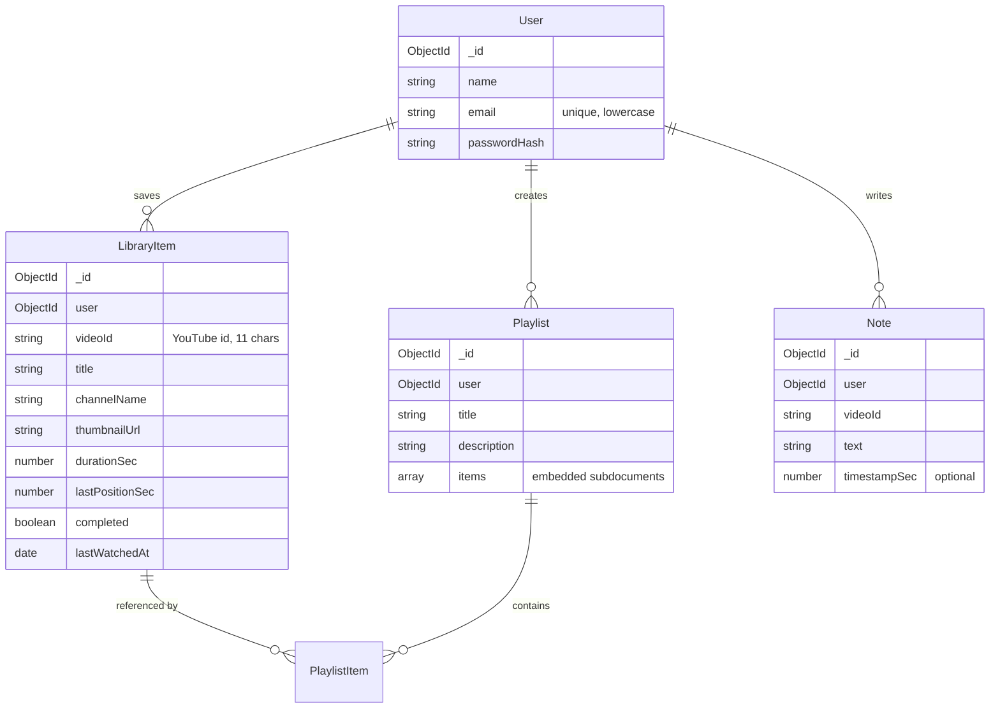

# Database Models

Four MongoDB collections cover the whole MVP. The guiding idea: **one
document per real-world thing**, and ownership is explicit in every one of
them.



## User — `server/src/models/User.js`

Straightforward account document. Two details matter:

- `passwordHash` (never the password itself; hashing happens in the auth
  route with bcryptjs).
- A `toJSON` transform strips `passwordHash` and renames `_id` to `id`, so
  user objects can be returned from routes without leaking anything:

```js
userSchema.set('toJSON', {
  transform(doc, ret) {
    ret.id = ret._id.toString()
    delete ret._id
    delete ret.__v
    delete ret.passwordHash
    return ret
  },
})
```

## LibraryItem — `server/src/models/LibraryItem.js`

The heart of the design. A `LibraryItem` is **one user's relationship with one
YouTube video** — it stores both the saved video's metadata *and* the watch
progress. Two collections ("saved videos" and "progress") would have needed a
1:1 join for every page, so they are one document here instead.

- `{ user, videoId }` has a **unique compound index**: a user can save a given
  video at most once, and lookups by user+video are fast.
- `progressPercent` is a **virtual** — computed on read, never stored:

```js
libraryItemSchema.virtual('progressPercent').get(function () {
  if (this.completed) return 100
  if (!this.durationSec || !this.lastPositionSec) return 0
  return Math.min(100, Math.round((this.lastPositionSec / this.durationSec) * 100))
})
```

- `durationSec` is *learned* while watching (the oEmbed endpoint does not
  provide duration): the player reports it with every progress update and the
  server stores it on first sight. One exception: saving a video from a
  Data API search result may pass a known `durationSec` (clamped to 0–48 h)
  so the library shows the right length immediately.
- `progressSavedAt` stores the client timestamp of the newest accepted
  progress write. Writes carrying an older-or-equal `savedAt` are ignored
  as duplicates — the conflict rule that makes retries and offline replay
  safe (details in [`progress-sync.md`](progress-sync.md)).

## Playlist — `server/src/models/Playlist.js`

A playlist belongs to a user and embeds its members as an array:

```js
items: [
  {
    libraryItem: { type: ObjectId, ref: 'LibraryItem', required: true },
    addedAt: { type: Date, default: Date.now },
  },
]
```

Why embedded instead of a separate `PlaylistItem` collection?

- Playlist entries have no life of their own — no fields beyond the reference
  and the added date.
- The detail view needs the whole list in one query (`populate
  'items.libraryItem'`).
- Playlist progress is simply "how many member items have
  `completed: true`" — see `toPlaylistSummary()` in
  [`server/src/routes/playlists.js`](../server/src/routes/playlists.js).

The trade-off is the one consistency rule the code must maintain itself: when
a video is removed from the library, any playlist references to it must go
too (the delete route does this with one `$pull` update):

```js
await Playlist.updateMany(
  { user: req.user._id },
  { $pull: { items: { libraryItem: item._id } } },
)
```

## Note — `server/src/models/Note.js`

Notes are keyed by `{ user, videoId }` — **not** by a `LibraryItem` reference.
That choice is deliberate:

- You can take notes on a video *before* deciding to save it.
- Removing a video from the library does not destroy your notes; saving the
  video again brings them back (like a notebook that outlives a shelf).
- `timestampSec` is optional; when present, the UI renders it as a clickable
  chip that seeks the player back to that moment.

## Bookmark — `server/src/models/Bookmark.js`

Bookmarks mark a **playback position** to return to, with an optional short
label. They share the `(user, videoId)` keying (and the ownership pattern)
with notes, but are a separate collection rather than a `kind` field on
notes, because the shape and the interaction differ: a bookmark is a
one-click position marker (the player's current time plus a label), while a
note is written text. Merging them would force either nullable-everything
schemas or empty body fields on half the documents.

- `positionSec` is stored rounded to whole seconds; posting a second
  bookmark for the same rounded second returns the existing one
  (`alreadySaved: true`) instead of creating a duplicate.
- `GET /api/bookmarks` without a `videoId` returns all of the user's
  bookmarks — that powers the library's "Bookmarked" filter.

## Statistics — computed, not stored

There is no `Stat` collection. `GET /api/stats`
([`server/src/routes/stats.js`](../server/src/routes/stats.js)) folds the
user's existing `LibraryItem`/`Playlist`/`Note`/`Bookmark` documents in plain
JavaScript on every request. Numbers that can never drift from the source
data are worth more than an aggregation pipeline here — a personal library
is dozens of documents, not millions. The trade-off: stats recompute on
read, which is exactly what you want after every progress update anyway.

## How Ownership Is Enforced

Every query in the routes includes the user, which makes cross-user access a
non-event — the document simply is not found:

```js
// server/src/routes/library.js
const item = await LibraryItem.findOne({
  _id: req.params.itemId,
  user: req.user._id,        // ← ownership filter
})
if (!item) throw httpError(404, 'Video not found in your library.')
```

`scripts/api-test.sh` verifies this with a second test user: reading,
editing, and deleting another user's resources all return 404, and list
endpoints return empty arrays, never other people's data.
