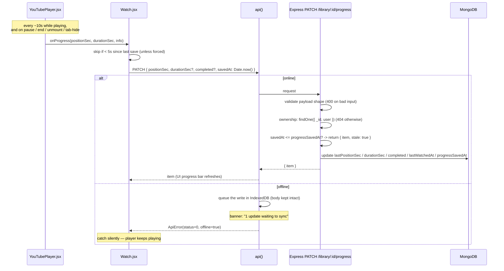

# Feature Walkthroughs

This document traces each major feature end-to-end: from the user's
action in the browser, through the API and the database, and back to
the UI. Each walkthrough includes a sequence diagram and a 10-step
explanation with file paths and function names.

For the high-level architecture, see
[`00-overview.md`](00-overview.md). For schemas and endpoint
contracts, see [`api-and-data-design.md`](api-and-data-design.md).

---

## Walkthrough 1 — Signup and Login

### What it does

A new user signs up with name, email, password. The server hashes the
password, creates a `User` document, signs a JWT, and returns it. The
client stores the token in `localStorage` and the user object in
`AuthContext`. On subsequent loads, the token is verified via
`GET /api/auth/me`.

### Diagram

```mermaid
sequenceDiagram
    participant U as User
    participant B as Browser (Signup.jsx)
    participant A as AuthContext
    participant API as api()
    participant E as Express /auth
    participant DB as MongoDB

    U->>B: enters name, email, password
    B->>A: signup(name, email, password)
    A->>API: api('/auth/signup', {method:'POST', body:{name,email,password}})
    API->>E: POST /api/auth/signup (JSON)
    E->>E: validate fields (400 with fields if bad)
    E->>DB: User.findOne({email}) (409 if exists)
    E->>E: bcrypt.hash(password, 10)
    E->>DB: User.create({name, email, passwordHash})
    E->>E: signToken(user) -> JWT (sub=user.id, exp=7d)
    E-->>API: 201 { token, user }
    API-->>A: resolves { token, user }
    A->>A: setToken(token); setUser(user); setCachedUser(user)
    A-->>B: returns
    B->>B: navigate('/app') (via RequireAuth now passing)
```

### Step-by-step

1. **User submits the form.** `client/src/pages/Signup.jsx` calls
   `signup()` from `useAuth()`.
2. **AuthContext.signup.** `client/src/context/AuthContext.jsx` calls
   `api('/auth/signup', { method: 'POST', body: { name, email, password } })`.
3. **`api()` wraps.** Adds `Content-Type: application/json`, JSON-encodes
   the body, `fetch`es the relative `/api/auth/signup` URL.
4. **Vite proxy.** Dev server proxies `/api/auth/signup` to
   `http://localhost:4000/api/auth/signup`.
5. **Express middleware.** `cors` (allows the configured origin) →
   `express.json` (parses body into `req.body`) → security headers →
   the per-router `rateLimit({ max: 20, windowMs: 60_000 })`.
6. **Route handler** (`server/src/routes/auth.js`):
   - Validates each field; collects failures into a `fields` object.
   - Throws `httpError(400, 'Please check the highlighted fields.', fields)`
     if any.
   - `User.findOne({ email: normalizedEmail })` — 409 if exists.
   - `bcrypt.hash(password, 10)` — 10 rounds.
   - `User.create({ name, email, passwordHash })`.
   - `signToken(user)` from `server/src/middleware/auth.js`:
     `jwt.sign({ sub: user._id.toString() }, JWT_SECRET, { expiresIn: '7d' })`.
   - `res.status(201).json({ token, user })`. The `User.toJSON`
     transform strips `passwordHash` and renames `_id` to `id`.
7. **Response.** `api()` parses JSON, sees 201, returns the data.
8. **AuthContext stores.** `setToken(data.token)` writes to
   `localStorage['nd_token']`. `setUser(data.user)` triggers React
   re-render. `setCachedUser(data.user)` mirrors the profile to
   `localStorage['nd_user']` for offline restores.
9. **Navigation.** `RequireAuth` re-renders, sees `user`, lets the
   route through. The user lands on `/app` (Dashboard).
10. **On reload.** `useEffect` in `AuthProvider` runs on mount, sees
    a token, calls `GET /api/auth/me`. `requireAuth` verifies the
    token, loads the user fresh (so a deleted account stops working
    immediately), attaches to `req.user`, route returns
    `{ user: req.user }`. The `ready` flag is set after the call so
    `RequireAuth` waits — preventing a flash of `/login` on refresh.

### Error cases

- **Email already registered:** 409 with `fields.email` set. Form
  renders the message next to the email field.
- **Wrong password on login:** 401 "Incorrect email or password." —
  same message for unknown email, so the API cannot be used to probe
  which emails are registered.
- **Expired/invalid token on `me`:** 401. `AuthContext` drops the
  token, clears the cache, fires `nd:unauthorized` (handled by the
  same handler in the provider). User is redirected to `/login` by
  `RequireAuth`.
- **Network failure on `me`:** `err.offline` is true (status 0).
  `AuthContext` keeps the session using the cached profile mirror —
  doesn't log the user out for a dead connection. Next online load
  re-verifies the token.

### Why this flow

- **Stateless JWT:** no session store, no Redis. The token is the
  session. Trade-off: revocation requires expiry or a blocklist; we
  work around it by re-fetching the user on every request.
- **bcrypt 10 rounds:** deliberately not 12 — 10 is the documented
  sweet spot (about 100ms on a modern CPU), strong enough to deter
  brute force, fast enough to not DOS the login endpoint. The
  rate limiter (20/min) blunts brute force further.
- **Same message for unknown email vs. wrong password:** classic
  anti-enumeration pattern. An attacker cannot list valid emails by
  watching which produce "wrong password" vs. "no such account".

### Alternatives

- **httpOnly cookie + CSRF token:** XSS-resistant, but adds CSRF
  complexity and complicates the SPA + separate-API deployment.
  Documented as a future hardening step in `security.md`.
- **OAuth (Google, GitHub):** would let users sign in with existing
  accounts. Adds a dependency (`passport` or similar) and an external
  identity provider — not in scope.

---

## Walkthrough 2 — Saving a Video to the Library

Already traced in [`request-lifecycle.md`](request-lifecycle.md).
The short version is: click → `api('/library', { method: 'POST',
body: { videoId } })` → `requireAuth` → `extractVideoId` →
dedupe → oEmbed metadata → `LibraryItem.create` → 201 → React state
update → toast.

Three subtleties worth highlighting:

1. **Server re-validates the id.** Even though the client parsed it
   for instant feedback, `server/src/routes/library.js` calls
   `extractVideoId(req.body.videoId)` again. Client checks are
   convenience, never security.
2. **Dedup is by `(user, videoId)`.** Saving the same video twice
   returns the existing entry with `alreadySaved: true`. Backfills
   a known duration if one was supplied and the existing entry never
   learned one.
3. **oEmbed failure degrades gracefully.** If YouTube oEmbed is
   unreachable, the video is still saved with fallback metadata
   (`title: ''`, thumbnail from the documented pattern) and
   `metadataUnavailable: true` is flagged so the UI can explain.

---

## Walkthrough 3 — Watch and Progress Tracking

### What it does

The user opens `/app/watch/<videoId>`. The page loads metadata, the
player embeds, resumes from `lastPositionSec` if meaningful. While
playing, the player emits progress every ~10s. The watch page
throttles, sends `PATCH /library/:id/progress`, the server applies
the `savedAt` conflict rule.

### Diagram



### Step-by-step

1. **Player emits `onProgress`.** In
   `client/src/components/YouTubePlayer.jsx`:
   - `onStateChange` PLAYING starts a `setInterval(() => emitProgress(player), 10_000)`.
   - PAUSED/ENDED clear the interval and emit one final.
   - The effect's cleanup (unmount, video switch, tab-hide via
     `visibilitychange`/`pagehide` listeners) emits a final
     `unmount` or `interrupted` event if still playing.
2. **`Watch.jsx#handleProgress`.** Receives
   `(positionSec, durationSec, info)`.
   - If `info.resumed`, sets `resumedAt` (UI shows "Resumed from
     12:34" chip) and returns — no save needed for the resume seek.
   - `force = Boolean(info.ended || info.paused || info.unmount || info.interrupted)`.
   - If not forced and `positionSec - lastSavedPosition.current < 5`,
     return — throttle to one save per ~5s of new progress.
   - Update `lastSavedPosition.current = positionSec`.
   - Call `api('/library/${item.id}/progress', { method: 'PATCH',
     body: { positionSec, durationSec, completed?, savedAt: Date.now() } })`.
3. **`api()` wraps.** Bearer header, JSON body, fetch. On network
   failure: `handleNetworkFailure` matches
   `/library/([^/]+)/progress`, calls `queueProgress(itemId, body)`
   from `client/src/lib/offline.js`, throws an `ApiError` with
   `offline: true`. The `.catch(() => {})` in `handleProgress` swallows
   it — the player keeps playing.
4. **Express middleware.** `requireAuth` loads the user. The route
   handler validates the payload shape (`positionSec`, `durationSec`,
   `completed`, `savedAt` types).
5. **Ownership check.** `LibraryItem.findOne({ _id: req.params.itemId,
   user: req.user._id })` — 404 if not found (or not owned).
6. **Conflict rule.** If `savedAt <= item.progressSavedAt`, return
   `{ item, stale: true }`. The stored state is unchanged. (This is
   what makes retries and offline replays safe.)
7. **Update.** Apply `positionSec` (rounded), `durationSec` (if > 0),
   `completed` (if boolean), else auto-complete at
   `lastPositionSec >= durationSec * 0.95`. Set `lastWatchedAt = new Date()`.
   Set `progressSavedAt = savedAt`.
8. **Response.** `{ item }`. `api()` resolves. `Watch.jsx` calls
   `setLibraryItem(data.item)` — UI updates the progress bar / status
   badge.
9. **On `info.ended`:** `Watch.jsx#handleEnded` fires an additional
   PATCH with `{ completed: true, savedAt: Date.now() }` to make sure
   completion is recorded even if the periodic save missed the last
   few seconds.
10. **Resume on next visit.** `GET /library?videoId=...` returns the
    item with `lastPositionSec`. `Watch.jsx` passes `startAt =
    libraryItem.lastPositionSec` to `YouTubePlayer`. On `onReady`, if
    `startAt > 5` and `< duration - 10`, the player calls
    `seekTo(startAt, true)` and emits a `{ resumed: true }` progress
    event. `handleProgress` sees `info.resumed`, sets the `resumedAt`
    chip, and returns without saving.

### The throttle trade-off

- 10-second interval from the player.
- 5-second throttle in `handleProgress`.
- Worst case: one PATCH per 10 seconds of playback.
- Plus final saves on pause/end/unmount/tab-hide.

A shorter interval would catch more progress but spam the API. A
longer one would lose more on tab-close. 10s + 5s throttle is the
sweet spot for a personal app.

### Auto-completion at 95%

The server marks `completed: true` when `lastPositionSec >= durationSec * 0.95`.
Why 95% and not 100%? Because users close the tab at 96%, skip the
last seconds of credits, etc. — a video they've essentially finished
should count as finished. The player's `ENDED` event is the primary
trigger (sent at 100%); 95% is the backstop.

### `completed` is sticky

Once `completed: true`, plain progress writes never un-complete it.
The only way to mark a video un-completed is the **Start Over**
button, which sends `{ positionSec: 0, completed: false, savedAt: Date.now() }`
— a fresh, newer `savedAt` so the conflict rule lets it through.

### Alternatives

- **WebSocket push from server:** the server doesn't need to know
  playback position in real time. A PATCH every 10s is fine.
- **Server timestamps:** rejected for the conflict-rule reasons
  explained in `progress-sync.md` and
  [`api-and-data-design.md`](api-and-data-design.md#9-the-savedat-conflict-rule).

---

## Walkthrough 4 — Notes

### What it does

The user writes a note in the watch sidebar. Optionally attaches the
player's current time as a `timestampSec`. Saves via
`POST /api/notes`. Later edits or deletes via `PATCH`/`DELETE`. Notes
survive removing the video from the library (keyed by `(user, videoId)`,
not by `LibraryItem`).

### Step-by-step

1. **Compose.** User types in `NotesSection.jsx`. Optionally clicks
   "Attach current time" — calls `getPlayerTime()` (the `playerRef`
   handle from `Watch.jsx`) and stores it as the note's
   `timestampSec`.
2. **Submit.** `onSubmit` calls `api('/notes', { method: 'POST',
   body: { videoId, text, timestampSec } })`.
3. **Server.** `server/src/routes/notes.js`:
   - Validates `videoId` (`extractVideoId`), `text` (1–2000 chars),
     `timestampSec` (non-negative number or null).
   - `Note.create({ user, videoId, text: text.trim(), timestampSec: Math.round(...) })`.
   - `201 { note }`.
4. **UI update.** `Watch.jsx#setNotes((current) => [...current, data.note])`.
   The list re-renders. If the note has a `timestampSec`, the chip is
   rendered as a clickable `<button>` that calls `onSeekTo(timestampSec)`.
5. **Seek.** `Watch.jsx#seekTo(sec)` calls
   `playerRef.current?.seekTo?.(sec, true)`. The player jumps to
   that moment. The notes component never touches the player
   directly — it goes through the parent's `onSeekTo` prop.
6. **Edit/Delete.** `PATCH /api/notes/:id` updates text or timestamp.
   `DELETE /api/notes/:id` removes. Both find by `{ _id, user }` —
   ownership filter — so a cross-user edit returns 404.
7. **Survives library removal.** Notes are keyed by `(user, videoId)`,
   not by `LibraryItem`. When you delete a video from your library,
   the notes stay. Re-saving the video brings them back.

### Why `(user, videoId)` instead of `(user, LibraryItem)`

- You can take notes on a video before saving it.
- Notes survive library removal.
- Looking up notes for a video is a single index hit
  (`{ user, videoId }`).

### Trade-offs

- The notes route does not validate that the video exists. A user
  could POST notes for an arbitrary 11-char id. Harmless — the notes
  are theirs and tied to a video id that may or may not exist on
  YouTube. The UI only loads notes for the currently-watched video,
  which has been validated by the metadata route.

---

## Walkthrough 5 — Bookmarks

Very similar to notes. Differences:

- `positionSec` is **required** (a bookmark without a position is
  meaningless).
- `label` is optional, ≤ 120 chars.
- **Duplicate guard:** posting a second bookmark for the same rounded
  second of the same video returns the existing one with
  `alreadySaved: true`. The check is
  `Bookmark.findOne({ user, videoId, positionSec: Math.round(positionSec) })`.
- The "Bookmark" button is also wired to the **B keyboard shortcut**
  in focus mode (`Watch.jsx#onKeyDown` case `'b'`).

The single POST handler covers both the sidebar form and the keyboard
shortcut — `Watch.jsx#addBookmark(positionSec, label)` is called by
both.

---

## Walkthrough 6 — Playlists

### Lifecycle

1. **Create.** `POST /api/playlists` with `{ title, description? }`.
   Returns a summary.
2. **Add a video.** `POST /api/playlists/:id/items` with
   `{ libraryItemId }`. The video must already be in the library
   (playlists reference library items, not raw video ids). Returns
   `alreadyInPlaylist: true` if it's already there.
3. **View.** `GET /api/playlists/:id` returns the detail shape with
   populated videos (the `populate('items.libraryItem')` call).
4. **Reorder.** `PATCH /api/playlists/:id/items/order` with
   `{ order: [entryId, …] }`. The `order` array must be a permutation
   of the current entry ids — every entry exactly once. The handler
   rebuilds the array in the new order, preserving each entry's
   `addedAt`. Saves the document.
5. **Remove a video.** `DELETE /api/playlists/:id/items/:itemId`.
   Removes one entry. The `LibraryItem` itself is untouched —
   removing from a playlist doesn't remove from the library.
6. **Edit metadata.** `PATCH /api/playlists/:id` updates title or
   description.
7. **Delete the playlist.** `DELETE /api/playlists/:id`. Removes the
   playlist. **Library items are untouched** — deleting a playlist
   never deletes the videos.

### Why the permutation validation

`order` must contain every current entry exactly once. This makes
the write atomic and unambiguous — the server doesn't have to
interpret "what did the user mean?" if some entries are missing or
duplicated. Rejects with 400 otherwise:

```js
if (
  !Array.isArray(order) ||
  order.length !== currentIds.length ||
  new Set(order.map(String)).size !== order.length ||
  !order.every((id) => currentIds.includes(String(id)))
) {
  throw httpError(400, 'Order must list every video in the playlist exactly once.')
}
```

### Why `alreadyInPlaylist`

A `PlaylistItem` is just `{ libraryItem, addedAt }` — there's no
unique index. The handler checks for an existing entry before
adding. Without that check, the same video could be added twice,
which would make `completedCount / itemCount` misleading.

### Playlist completion (computed on read)

```js
function toPlaylistSummary(playlist) {
  return {
    // ...
    itemCount: playlist.items.length,
    completedCount: playlist.items.filter((i) => i.libraryItem?.completed).length,
    next: nextVideoOf(playlist),
    // ...
  }
}
```

`next` is the first not-yet-completed video. Powers:
- Dashboard's "Unfinished playlists" section
- Playlist header's "Continue" button
- Watch sidebar's "Up next" panel

---

## Walkthrough 7 — YouTube Search & Playlist Import

### What it does

The Discover page (`client/src/pages/Search.jsx`) lets the user search
YouTube and preview/import playlists. Both use the **optional**
YouTube Data API v3, gated by `YOUTUBE_API_KEY`.

### Search flow

1. User types a query (2–100 chars), submits.
2. `api('/videos/search?q=...')`.
3. **Server:** `routes/videos.js#GET /videos/search`:
   - `rateLimit({ max: 10, windowMs: 60_000 })` (each search costs 100
     Data API quota units).
   - `requireAuth`.
   - `isYouTubeApiConfigured()` — if no key, returns `501 { configured: false }`.
   - Validates query length (2–100).
   - `searchYouTubeVideos(q)` from `utils/youtube.js`:
     - Calls Data API `search.list` with `part=snippet, type=video, maxResults=12`.
     - Extracts video ids from results.
     - Calls `videos.list` once with `part=snippet,contentDetails` for
       all ids (1 quota unit) to fill in durations.
     - Returns parsed video metas (id, title, channelName, thumbnailUrl,
       durationSec).
4. **Response:** `{ results: [...], configured: true }`.
5. **UI:** Renders `VideoCard`s. Each card has a "Save to library"
   button that calls `POST /api/library` with `{ videoId, durationSec }`
   (the duration is known from the Data API, so the library item
   shows the right length immediately — unlike oEmbed saves).

### Import flow

1. User pastes a playlist URL, submits.
2. `api('/videos/playlist?url=...')` for preview.
3. **Server:** `routes/videos.js#GET /videos/playlist`:
   - Same rate limit (10/min).
   - `extractPlaylistId(url)` parses the URL.
   - `fetchYouTubePlaylist(playlistId)`:
     - `playlists.list` (1 unit) — gets title, channel.
     - `playlistItems.list` with `maxResults=50` (1 unit) — gets
       video ids.
     - `fetchVideosByIds(entries)` (1 unit) — gets metadata + durations.
     - Returns `{ id, title, channelName, itemCount, truncated, videos }`.
4. **UI preview:** Shows the playlist title, video count, and the
   list. A "Import" button confirms.
5. **Import:** `POST /api/playlists/import` with `{ url, title? }`.
   - Server-side rate limit: 5/min.
   - `fetchYouTubePlaylist(playlistId)` again (no caching across the
     preview + import — small cost).
   - For each video:
     - `LibraryItem.findOne({ user, videoId })` — if exists, update
       metadata (title/channel/duration if changed/backfillable), do
       not touch progress fields. Increment `alreadySaved` count.
     - Otherwise `LibraryItem.create(...)` with full metadata +
       duration. Increment `imported` count.
   - `Playlist.create({ user, title, description, items: [...] })`.
   - Returns `201 { playlist, imported, alreadySaved, truncated }`.
6. **UI:** Navigates to the imported playlist's detail page.

### Quota handling

- **403 from Google** → `YouTubeApiError` with `status: 429` and a
  friendly message ("quota exhausted, try tomorrow"). The route
  propagates this as a 429 to the client.
- **Network failure** → standard `ApiError`.
- **Rate limit on our side** (10/min, 5/min) → 429 with `Retry-After`.

### Why the Data API is server-side only

The API key never leaves the server. If we called the Data API from
the browser, the key would be visible in network requests and
stealable. Server-side also lets us rate-limit per user (a runaway
client can't drain the quota).

### Compliance boundaries (unchanged)

- Only documented Data API endpoints.
- No scraping, no stream extraction, no downloading.
- Playback stays inside YouTube's iframe.

---

## Walkthrough 8 — Focus Mode

### What it does

Hides navigation and side panels, gives the video the full width,
and adds keyboard shortcuts.

### How

- **Toggle.** Button in `Watch.jsx`. Sets `focusMode` state to
  `true`/`false`.
- **CSS.** `useEffect` toggles `document.body.classList.toggle('nd-focus', focusMode)`.
  The CSS rule in `client/src/index.css` hides `.nd-chrome` (the
  navbar + bottom tab bar) and adjusts the layout.
- **Sidebar.** `{!focusMode && <aside>...</aside>}` — the side panel
  is not rendered when focus mode is on.
- **Exit button.** Top-right of the player, with an Esc kbd hint.

### Keyboard shortcuts (active while a video is open)

| Key | Action |
| --- | --- |
| Space / K | Toggle play/pause |
| ← / → | Seek 5 seconds back/forward |
| B | Bookmark current position |
| F | Toggle fullscreen |
| Esc | Exit focus mode |

### The input guard (critical)

```js
function onKeyDown(event) {
  if (event.metaKey || event.ctrlKey || event.altKey) return
  const target = event.target
  if (
    target instanceof HTMLElement &&
    target.closest('input, textarea, select, [contenteditable="true"]')
  ) {
    return
  }
  // …
}
```

Without this guard, pressing Space while typing a note would pause
the video, B would create a bookmark, etc. The guard checks whether
the focused element is a text input (or any descendant of one) and
bails.

### Alternatives

- **A library like `react-hotkeys-hook`.** Useful when you have many
  shortcuts with complex combos. For five shortcuts, an inline
  `keydown` listener is clearer.
- **Mousetrap.** Same reasoning.

---

## Walkthrough 9 — Offline Mode

### What it does

When the network is unavailable:

- The app shell loads from the service worker cache.
- Library, playlists, notes, bookmarks, stats stay readable
  (IndexedDB read-through).
- Failed progress PATCHes queue in IndexedDB and replay on reconnect.
- The session survives (the cached user profile is used until
  re-verification is possible).
- The user sees an `OfflineBanner` explaining what's happening.

### Layers

1. **Service worker** (`client/public/sw.js`) — caches the SPA shell,
   hashed assets, and thumbnails. Never intercepts `/api`.
2. **IndexedDB read-through** (`client/src/lib/offline.js`) — caches
   GET responses for cacheable paths.
3. **Progress queue** — failed PATCH `/library/:id/progress` calls
   are stored with their original body (including `savedAt`).
4. **Replay** (`client/src/lib/api.js#flushProgressQueue`) — runs on
   `online` event, every 30 seconds via `setInterval`, and via a
   manual "Sync now" button in the OfflineBanner.

### Replay and idempotence

The server's `savedAt` rule (see
[`api-and-data-design.md`](api-and-data-design.md#9-the-savedat-conflict-rule))
makes replays idempotent:

- Replay the same write twice → second one is older → `stale: true`,
  no state change.
- Replay a write the user has since superseded online → the queued
  write is older → ignored.
- Replay a write the user wants to be the newest (e.g., they watched
  further offline than the server knew) → it's newer → applied.

This is why *only progress* is queued. Notes and bookmarks don't have
a conflict rule; queueing them would require client-generated IDs
and merge logic. They fail loudly instead of silently deferring —
honest failures over silent corruption.

### Logout clears everything

`AuthContext#logout` calls `clearQueue()` + `clearCache()` and drops
the cached profile. The next user on the same browser never sees the
previous user's queued progress or cached library.

### What doesn't work offline

- Watching videos (YouTube's player needs the network).
- Searching YouTube or importing playlists (Data API).
- Signing up.
- Editing notes/bookmarks (only progress is replay-safe).

These are honest failures, not silent queues. The UI tells the user.

---

## Walkthrough 10 — Statistics

### What it does

`GET /api/stats` returns the user's learning activity, computed from
existing documents (no `Stat` collection). The Stats page renders
this.

### Computation

In `server/src/routes/stats.js`:

1. `Promise.all([LibraryItem.find({user}), Playlist.find({user}).populate('items.libraryItem'), Note.countDocuments({user}), Bookmark.countDocuments({user})])`.
2. Fold videos: completed count, in-progress count, position-based
   `watchedSec` estimate, `remainingSec` for in-progress.
3. Fold playlists: completed (all items done), unfinished (with
   `next` video), sorted by completion %.
4. Build last-7-days activity from `lastWatchedAt` per day.
5. Compute streak (consecutive days with activity, ending today or
   yesterday).

### Honest metrics

`estimatedMinutes` is **position-based**: for completed videos, the
full duration; for in-progress, the last position. It is *not*
measured watch time (the IFrame API doesn't expose that). The UI
labels it "estimated learning time" deliberately.

`activity[].count` counts videos whose `lastWatchedAt` falls on that
day. A video watched across several days counts once, on the latest
day. Honest, simple, matches what the user expects.

### Why compute on read

- Numbers cannot drift from source data.
- A personal library is small enough that the fold is sub-ms.
- Every progress update changes the numbers; recomputing on read
  always shows fresh data.

### Alternatives

- **Aggregation pipeline.** Faster at scale, but harder to read and
  not needed here.
- **Stored stats collection.** Snapshot on every write — but then you
  have two sources of truth that can drift, and a write-ahead log to
  maintain.

---

## Common Patterns Across Walkthroughs

- **One `api()` wrapper for everything.** Auth header, JSON,
  errors, offline — uniform across every request.
- **Ownership filter everywhere.** `findOne({ _id, user })`. Cross-user
  access is a 404, never a leak.
- **Validation per-route.** Per-field error messages, 400 on failure.
- **Central error handler.** Uniform shape, no leakage.
- **Effects with `cancelled` flags.** Prevent stale-request state
  updates on rapid navigation.
- **`useRef` for things callbacks need to read without re-creating.**
  `playerRef`, `lastSavedPosition`, `libraryItemRef`, `handlers` in
  `YouTubePlayer`.

---

Next: [`technologies-and-dependencies.md`](technologies-and-dependencies.md)
covers every dependency: what it provides, why chosen, alternatives,
trade-offs.
