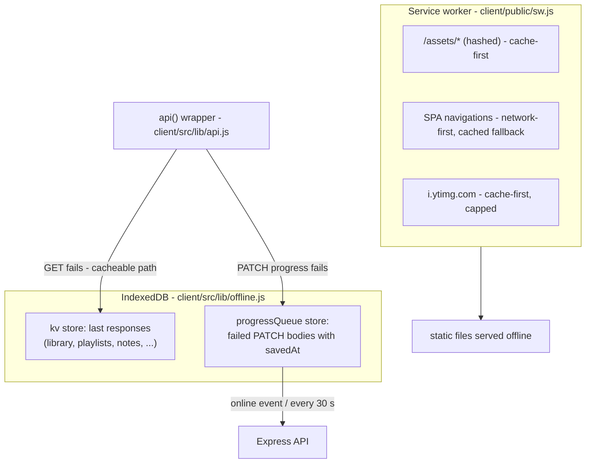

# Offline Support

What works without a network, how, and — just as important — what does
not. Sources: [`client/public/sw.js`](../client/public/sw.js),
[`client/src/lib/offline.js`](../client/src/lib/offline.js),
[`client/src/lib/api.js`](../client/src/lib/api.js),
[`client/src/components/OfflineBanner.jsx`](../client/src/components/OfflineBanner.jsx).

**The hard boundary first:** YouTube videos are *never* downloaded,
cached, or rehosted. Playback always happens inside YouTube's official
embedded player and always requires an internet connection. Everything
offline in this app is either our own data (notes, bookmarks, progress,
library metadata) or the app's own static files.

## What Works Offline

| Capability | Mechanism |
| --- | --- |
| App loads on repeat visits | service worker caches the SPA shell + hashed assets |
| Library, playlists, stats, notes, bookmarks readable | IndexedDB read-through cache of the last API responses |
| Session survives a reload | profile mirrored to `localStorage` (see below) |
| Progress keeps being recorded | failed progress PATCHes queue in IndexedDB, replay automatically |
| Thumbnails reappear | service worker caches `i.ytimg.com` images (capped at 300) |

What does **not** work offline: watching videos, searching YouTube,
importing playlists, signing up, and *editing* notes/bookmarks — those
are honest failures, not silent queues. Only progress writes are queued,
because a progress write is naturally idempotent (see below) while a note
creation would need client-generated IDs and merge logic we deliberately
did not build.

## The Two Layers



The service worker **never intercepts `/api`** — API data must not go
stale via HTTP caching; the IndexedDB layer handles offline reads instead
with explicit "you are seeing saved data" signaling. The worker is
registered only in production builds
([`client/src/main.jsx`](../client/src/main.jsx)) because it would fight
Vite's dev-server hot reload:

```bash
npm --prefix client run build
npm --prefix client run preview   # http://localhost:4173 — try DevTools offline
```

## The Read-Through Cache

`api()` caches successful `GET`s for a fixed set of endpoints
(`cacheKeyForPath` in `offline.js`): the library list, playlists list,
stats, and per-video note/bookmark/library lookups. Auth responses are
never cached. On a network failure, `api()` serves the cached copy and
emits an `nd:offline-data` event; the `OfflineBanner` then shows
"You're offline — showing your last saved data".

The session itself: `GET /auth/me` failing *offline* used to look like an
expired token and log the user out. `AuthContext` now distinguishes
network errors (status 0) from 401s and restores the profile from a
`localStorage` mirror. The token is re-verified on the next online load.

## The Progress Queue & Sync

When a `PATCH /library/:id/progress` fails due to the network, `api()`
queues `{ itemId, body, queuedAt }` — the body intact, including its
original `savedAt`. Replay happens:

- on the browser's `online` event, and
- every 30 seconds while entries remain, and
- via a manual "Sync now" link in the banner.

Replay is one real HTTP request per entry, in order. Successful and
permanently-rejected (4xx) entries are removed; network errors stop the
replay for the next attempt. **Idempotence comes from the server's
`savedAt` rule** ([progress-sync.md](progress-sync.md)): a replayed write
that is not newer than what the server has is ignored, so double-replays
and races with online updates cannot corrupt progress.

The chosen conflict policy, plainly: *newest client timestamp wins; older
writes are dropped*. If the user watched further online than an old
offline entry claims, the online progress stays. If the offline session
is the newest, it wins. We never merge positions.

## Privacy on Logout

The cache and queue hold one user's data. `logout()` (and automatic 401
logout) calls `clearQueue()` + `clearCache()` and drops the mirrored
profile — nothing of the previous account survives into the next login on
the same browser. The service worker's static caches contain no user data
at all.

## Limitations

- Offline edits to notes/bookmarks fail loudly rather than queueing (only
  progress is replay-safe without a real sync engine).
- Cached reads are stale-by-definition; there is no refresh-on-reconnect
  beyond the page simply re-requesting when it next loads.
- The queue lives in one browser profile. Offline progress on a phone and
  a laptop is two independent queues, ordered by each device's clock.
- The service worker only serves the production build; `npm run dev` is
  online-only by design.
