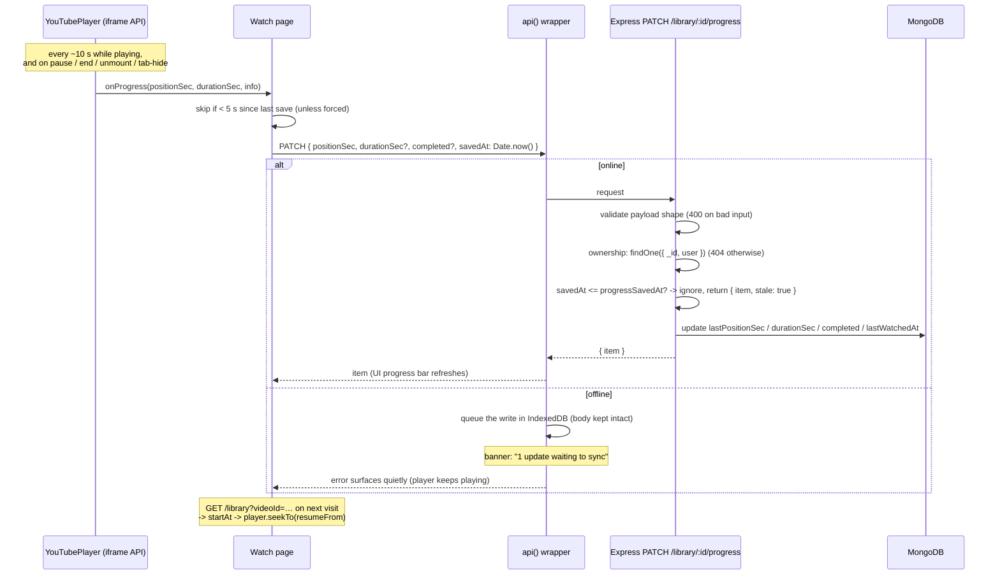

# Progress Tracking & Synchronization

How "resume where you left off" works end to end, including the conflict
rule that keeps offline writes safe. Source files:
[`client/src/components/YouTubePlayer.jsx`](../client/src/components/YouTubePlayer.jsx),
[`client/src/pages/Watch.jsx`](../client/src/pages/Watch.jsx),
[`server/src/routes/library.js`](../server/src/routes/library.js).

## The Lifecycle

## When the player reports progress

The IFrame Player API gives us events, not a stream. The component listens
to `onStateChange`:

- **PLAYING** → start a 10-second interval that reads
  `getCurrentTime()`/`getDuration()` and emits progress
- **PAUSED / ENDED** → one final emit (and `completed: true` on end)
- **Unmount** (navigating away or switching videos) → a final emit before
  the player is destroyed
- **`visibilitychange` → hidden / `pagehide`** → an emit *only if still
  playing*, so closing the tab mid-video loses at most a few seconds

The Watch page then applies a small throttle: a save is skipped if less
than **5 seconds** of progress happened since the last one, *unless* the
emit was forced (pause/end/unmount/interrupt). Worst case the app issues
one PATCH per 10 s of playback — not one per player event.

## Completion

A video counts as **completed** when:

1. the player fires `ENDED` (the client sends `completed: true`), or
2. a progress write reaches **≥ 95 %** of the known duration — the server
   computes this so a user who closes the tab at 96 % still gets credit.

`completed` is sticky: plain progress writes never un-complete a video.
Rewatching from the start works through the explicit "Start over" action,
which sends `{ positionSec: 0, completed: false }` with a fresh `savedAt`.

## The Conflict Rule: `savedAt`

Every progress write may carry `savedAt` — a millisecond timestamp from
**the client's clock**. The server keeps `progressSavedAt`, the timestamp
of the newest write it accepted, and applies one rule:

> If the request's `savedAt` is **not newer** than the stored
> `progressSavedAt`, the write is a duplicate or a stale replay: keep the
> stored state and answer `{ item, stale: true }`.

Why client clocks instead of server timestamps? Because a replayed offline
write must look *old*. If the server stamped writes on receipt, a queued
write replayed hours later would arrive "now", appear newest, and clobber
progress the user made online in between. With client timestamps the
replay carries the original moment and the server ignores it.

What the rule buys:

- **Retries are idempotent.** The same request twice = one update.
- **Offline replay is safe.** The queue replays in order; the server keeps
  only the newest.
- **Deliberate rewinds still work** (Start over), because they carry a
  *newer* `savedAt` than the previous write.

Honest limitations, accepted for a single-user app:

- Two devices with skewed clocks can misorder writes (rare, harmless here).
- Simultaneous playback on two devices is last-writer-wins among newer
  writes; the UI does not resolve per-second conflicts.
- Progress exists only for **saved** videos — the `LibraryItem` *is* the
  progress record (see [database-models.md](database-models.md)).

## Playlist Completion

Playlists compute completion on read from their entries' `LibraryItem`s:
`completedCount / itemCount`, plus a `next` field (first uncompleted
video) used by the dashboard's "Unfinished playlists", the playlist
header's Continue button, and the watch sidebar's "Up next". No stored
aggregate — the same single-source-of-truth rule as stats.
