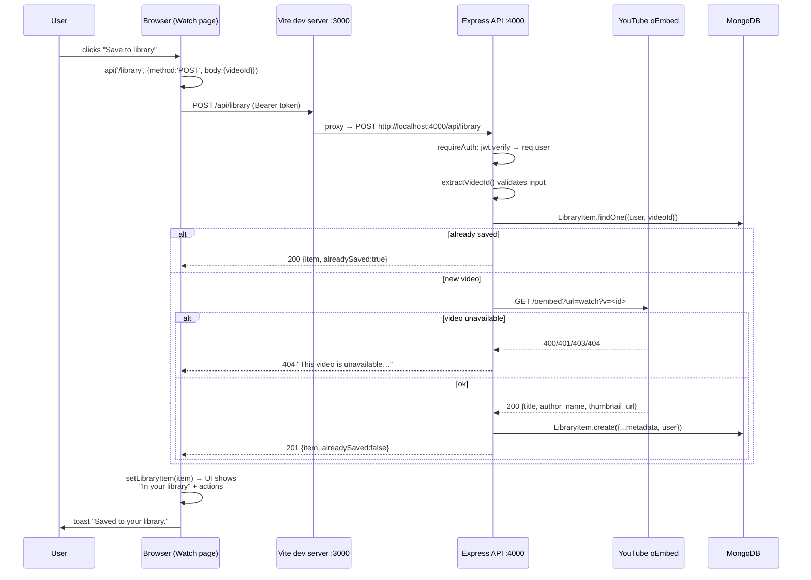

# Request Lifecycle

How one click travels from the browser, through Vite and Express, to MongoDB
and back — using a real example from the codebase: **saving a video from the
watch page**.



## Step by Step

### 1. The click (browser)

The watch page's save button calls the `api()` wrapper
(`client/src/lib/api.js`), which adds the stored token as a Bearer header,
JSON-encodes the body, and `fetch`es a **relative** URL:

```js
const data = await api('/library', { method: 'POST', body: { videoId } })
```

Relative is important: the browser only ever knows about its own origin
(port 3000), which is what makes the setup work in any environment.

### 2. The proxy (Vite)

`client/vite.config.js` forwards everything under `/api`:

```js
proxy: { '/api': { target: 'http://localhost:4000', changeOrigin: true } }
```

This exists purely for development. In production you would serve the built
client and the API from the same origin (or configure CORS — the API already
allows `CLIENT_ORIGIN`).

### 3. The middleware chain (Express)

`POST /api/library` first passes two app-level middleware in
`server/src/index.js`:

```js
app.use(cors({ origin: process.env.CLIENT_ORIGIN || 'http://localhost:3000' }))
app.use(express.json())   // parses the JSON body into req.body
```

then the router-level guard in `server/src/routes/library.js`:

```js
router.use(requireAuth)   // verifies the JWT, sets req.user
```

### 4. The route handler

The handler re-validates the input server-side (never trust the client),
checks for a duplicate, and fetches authoritative metadata itself:

```js
const videoId = extractVideoId(req.body.videoId)     // 400 if not a YouTube id
const existing = await LibraryItem.findOne({ user: req.user._id, videoId })
if (existing) return res.json({ item: existing, alreadySaved: true })

const metadata = await fetchVideoMetadata(videoId)   // oEmbed, 10s timeout
if (!metadata && !fetchFailed) throw httpError(404, 'This video is unavailable…')

const item = await LibraryItem.create({ user: req.user._id, videoId, ...metadata })
res.status(201).json({ item, alreadySaved: false })
```

Express 5 forwards any thrown error (including from `await`s) to the central
error handler, which turns known error types into safe JSON — validation
errors become 400s with per-field messages, unexpected errors become a
generic 500 with details only in the server log.

### 5. Back in the browser

`api()` sees a 2xx, parses the JSON, and returns `{ item, alreadySaved }`.
The watch page calls `setLibraryItem(item)`, React re-renders the action row
("In your library" + Add to playlist / Remove), and a toast confirms the
save. From here the player's progress callbacks start PATCHing
`/library/:id/progress` every few seconds — the same path, minus oEmbed.

## The Other Direction (server → YouTube → DB)

The only outbound call in the whole flow is the oEmbed lookup, made from the
server with a 10-second timeout. If YouTube is unreachable, saving still
succeeds with fallback metadata — the learning experience degrades before it
breaks.
